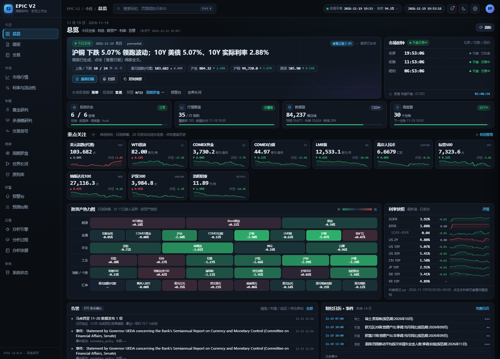
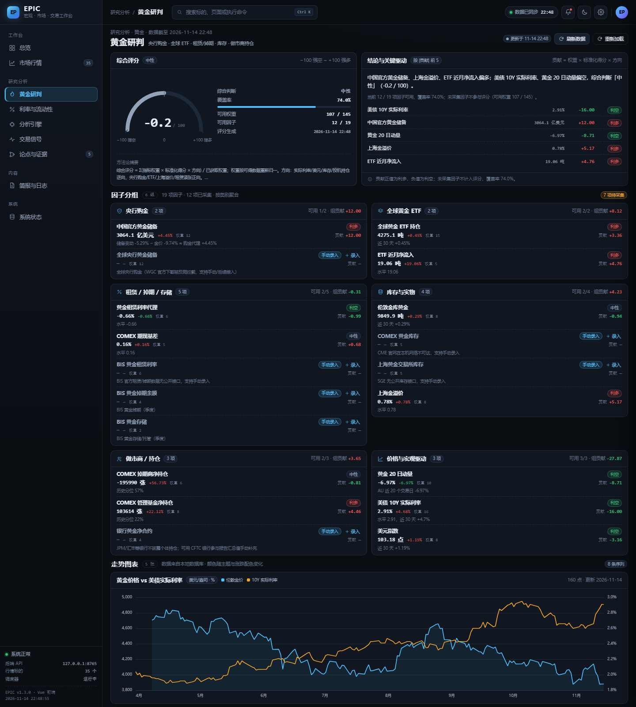

# EPIC · 个人市场分析工具

> **Economic Positioning, Intelligence & Cycles** —— 本地运行、以证据为中心的个人宏观—市场—交易决策工作台。
>
> 状态：**V2.0.0 — 多透镜宏观研判台（2026-11-19 增量）**：在 V2.0.0（玻璃盒血缘、EPIC-C 2.0 周期引擎、1500–2026 世界长河、预测台账与原则库、交易台账）之上，把「双透镜」扩展为**13 套研判透镜**——美联储一脉、宋鸿兵框架、宏观层、微观层，加上达里奥/德鲁肯米勒/马克斯/冈拉克/埃里安/波萨/佩蒂斯/辜朝明与政策四人体（拉加德/植田和男/贝森特/潘功胜）；**17 个路由页面**、**V2.0 API 端点族 39+ 条**、**358 条后端 pytest**。数据快照（2026-11-19）：**35 标的**、约 **8.4 万根日线**、约 **3.4 万条宏观观测 / 57 条宏观序列**（利率汇率 + 美联储 H.4.1 资产负债表 / H.6 货币供应 / 纽约联储货币市场 / 美国财政部 Fiscal Data / 世界银行 / IMF WEO）、**2,600+ 财经日历**、**13 品种会员持仓（Top20 多空明细）**、约 **290 篇官方新闻 / 4,000 条断言**；**黄金监控 22 指标**（20 项自动采集 + 2 项手动录入，17 项参与评分，coverage 100%）；周期引擎 7 条结构性读数中 3 条已由实时序列供给；LLM 待 Key。多透镜把每套框架做成可计算读数、可证伪规则与加权合成研判，输出 7 类资产共识、多镜共振/分歧对、90 天三情景与规则命中的预警（见 [`docs/27`](docs/27-双透镜-美联储与宋鸿兵.md)、[`docs/28`](docs/28-原始需求达成度审计.md)、[`docs/29`](docs/29-数据源与数据完整性.md)）。





---

## 快速开始

### 前置条件

| 项 | 要求 |
|---|---|
| 操作系统 | Windows 10/11；Windows PowerShell 5.1+ 或 PowerShell 7 |
| Python | **无需预装**：`setup.ps1` 会用 uv 在工作区 `.python/` 内安装 3.12（不修改系统环境）；已有 Python 3.12 则直接复用 |
| Node.js | **22+**（含 npm）。前端构建需要；本机 `npm.ps1` 可能被执行策略拦截，请使用 `npm.cmd` |
| 网络 | 首次初始化与首次启动需联网（安装依赖、构建前端、回补行情/利率/新闻等） |

### 首次安装与启动

```powershell
# 1) 初始化：引导 Python 3.12 → 创建 .venv → 安装依赖 → 初始化数据库与种子 → 构建前端
powershell -ExecutionPolicy Bypass -File .\scripts\setup.ps1

# 2) 启动：默认后台运行，就绪后自动打开浏览器
powershell -ExecutionPolicy Bypass -File .\scripts\start.ps1
```

- 前端：**http://127.0.0.1:8765**
- FastAPI 交互式 API 文档：**http://127.0.0.1:8765/docs**

首次安装约 2–5 分钟（取决于网络）。已在运行时再次 `start` 只提示、不会起第二个实例；端口被其他程序占用时**拒绝启动**并打印占用进程。

### 启动 / 停止 / 重启（Windows 一键脚本）

| 操作 | 命令 | 说明 |
|---|---|---|
| 启动 | `.\scripts\start.ps1` | 后台运行，写 `data\run\epic.pid`，就绪后自动打开浏览器 |
| 前台运行 | `.\scripts\start.ps1 -Foreground` | 占用当前终端，Ctrl+C 停止（排查问题首选） |
| 调试热重载 | `.\scripts\start.ps1 -Reload` | 前台运行，改代码自动重载 |
| 换端口 | `.\scripts\start.ps1 -Port 8766` | 也可在 `.env` 设 `EPIC_PORT` |
| 不弹浏览器 | `.\scripts\start.ps1 -NoBrowser` | CI / 远程场景 |
| 停止 | `.\scripts\stop.ps1` | 停止并释放端口，清理 PID 文件 |
| 强制停止 | `.\scripts\stop.ps1 -Force` | 仅当确认占用端口的是本项目服务 |
| 重启 | `.\scripts\restart.ps1` | 停止（若在运行）后重新启动 |

脚本行为要点：

- **后台脱离**：后台模式通过 WMI 创建进程，启动脚本立即返回；日志写入 `data\logs\server.{out,err}.log`。
- **就绪判定**：`/healthz` 返回 200 **且**端口归属在本次启动的进程树内（venv 的 `python.exe` 是启动器，真实服务是其子进程），避免"假成功"。
- **停止安全**：`stop` 优先停止真实服务进程（`server_pid`），失败再兜底 `taskkill /T /F`，并校验属于本项目进程，不会误杀。
- **换端口范围**：`.env` 的 `EPIC_PORT` 仅被 start/stop/restart 与服务本身读取；`dev.ps1`、`frontend/vite.config.ts` 的 `/api` 代理和 `ci.ps1` 的运行时检查**固定 8765**，换端口需同步修改。
- **受限终端**：若终端/安全策略禁止 WMI 创建进程（报"拒绝访问"），后台模式会失败；改用 `-Foreground` 前台启动。
- 所有 `.ps1` 均为 UTF-8 BOM，兼容 Windows PowerShell 5.1（中文不会乱码/解析失败）。

### 启动后会发生什么

- FastAPI 启动时：初始化数据库、写入种子（标的/自选/任务）、把上次中断的任务标记为 `interrupted`、启动 APScheduler。
- 后台 bootstrap 任务分批触发：行情/新闻/利率/财经日历/持仓/日线/黄金等**数据采集类在约 3–55 秒**，分析与决策类随后（约 4–5 分钟）；实际完成时间取决于网络。
- 之后按调度持续更新：行情每 5 分钟、新闻每 3 分钟、日线 15:40、数据质检 15:50、分析 16:10、信号/计划 16:30、黄金 16:40、预测对账 17:00、简报 07:30 / 21:00。

### 常用命令（项目根目录执行）

```powershell
# 手动任务：需让 app 包可导入（设置 PYTHONPATH；或先 cd backend 再执行）
$env:PYTHONPATH = "backend"
.\.venv\Scripts\python.exe -m app.jobs.runner --list          # 任务清单
.\.venv\Scripts\python.exe -m app.jobs.runner --job collect_quotes
.\.venv\Scripts\python.exe -m app.jobs.runner --job brief_manual   # 生成简报
.\.venv\Scripts\python.exe -m app.jobs.runner --all

# 质量门禁
.\.venv\Scripts\python.exe -m pytest -q                       # 358 条测试
.\.venv\Scripts\python.exe scripts\lint.py                    # 静态检查
powershell -ExecutionPolicy Bypass -File .\scripts\ci.ps1     # 前端构建 + lint + pytest + 运行时检查
powershell -ExecutionPolicy Bypass -File .\scripts\selfcheck.ps1
powershell -ExecutionPolicy Bypass -File .\scripts\check_acceptance.ps1   # 14 项 DoD

# 备份 / 恢复 / 清理
.\scripts\backup.ps1                                          # → data/backup/<时间戳>/
.\scripts\restore.ps1 -DryRun                                 # 先停止服务；-DryRun 只校验
.\scripts\maintain.ps1 -DryRun                                # 默认 DryRun，-Apply 才清理
```

- 简报：`--job brief_manual` 后打开「简报与日志」页；也可点击首页 Hero「查看日报」。
- 证据链：点击任意新闻 → 正文弹窗 + 数字断言高亮；深链 `http://127.0.0.1:8765/?doc=<document_id>`。
- 自检/门禁说明：`ci.ps1` 在服务未启动时会**跳过**运行时 health/acceptance/quality（不算失败）；`selfcheck.ps1` 会先构建前端再走同一门禁。

### 前端开发 / 构建

| 操作 | 命令 | 说明 |
|---|---|---|
| 构建前端 | `.\scripts\build.ps1` | `vue-tsc` + `vite build` → `web/`（FastAPI 直接托管）；**`web/` 是构建产物、不入版本库**，克隆后需先构建一次；首次会自动 `npm install` |
| 前端开发模式 | `.\scripts\dev.ps1` | 后端未跑会先拉起；Vite `:5173`，`/api`、`/healthz` 代理到 8765 |
| 类型检查 | `cd frontend; npm.cmd run typecheck` | vue-tsc |
| 依赖安装 | `cd frontend; npm.cmd install` | registry 已固定为 npmmirror（`frontend/.npmrc`） |

---

## 已接入的数据（2026-11-15 快照）

| 数据 | 来源 | 覆盖 |
|---|---|---|
| 国内期货日线 | 新浪 | 金银铜铝锌镍/原油/豆粕/铁矿/白糖/棉花/棕榈油，各约 2,000 根 |
| 国内期货实时 | 新浪 | 主力连续（价、涨跌、成交、持仓），约 3–60 秒 |
| A 股/指数 | 东方财富 | 沪深 300、洛阳钼业（日线 + 快照） |
| 外盘金银油铜 | 新浪 | 伦敦金银、COMEX 金银、WTI、Brent、LME 铜（约 15 分钟延迟，界面标注） |
| 汇率 | 新浪 | USDCNH/USDJPY/EURUSD/GBPUSD/USDCAD/USDSEK/USDCHF + 自算 DXY 代理 |
| 美元指数 / 离岸人民币日线 | 东方财富 | DXY、USDCNH 各约 2,000 根（2019–2026），另含实时报价 |
| 全球股指 | 东方财富 | 标普500、纳指100、道琼斯、恒生（日线约 2,000 根 + 实时） |
| LME 金属 | 新浪 | 伦铝/伦锌/伦镍：实时 + 日线各约 2,000 根（约 15 分钟延迟） |
| 美债利率 | 美国财政部 CSV | 2/5/10/30Y、5/10Y 实际利率、5/10Y 盈亏平衡，近 5 年日频 |
| 日/德国债 | 日本财务省 / 欧洲央行 | JP2Y/10Y/30Y、DE2Y/10Y、FR10Y（月频），近 4 年 |
| 中国国债 | 东方财富 | CN2Y/5Y/10Y/30Y、10Y-2Y 利差（源实际约 2 年日频） |
| 财经日历 | 东方财富 | 过去 180 天 + 未来 14 天经济数据（中/美/欧/日等），每 6 小时更新 |
| 会员持仓 | 上期所 / 郑商所 / 新浪（大商所） | 铜铝锌镍金银铅锡 + 棉花白糖 + 豆粕棕榈铁矿，共 13 品种 Top20 多空（日频） |
| 新闻政策 | 官方 RSS/HTML | 美联储、欧洲央行、日本央行、EIA、USTR、国家统计局（6 源） |
| 事件驱动 | 规则抽取 | 贸易/地缘/货币/供给/数据五类事件，自动关联标的（每 30 分钟） |
| 黄金监控 | LBMA / WGC（ETF + 央行仪表盘） / CFTC（COT + 银行参与报告） / MetalCharts（COMEX 库存镜像） / 上期所（黄金仓单） / 上金所（租借费率） / 东方财富 / 本地派生 | 22 指标中 **20 项自动采集**（17 项参与评分、coverage 100%），2 项 BIS 指标权重 0 保留手动；覆盖伦敦金库、全球黄金 ETF、全球央行储备、COMEX 库存、上期所黄金仓单、上金所 3M 租借费率、CFTC 持仓 + 派生指标 |

> 限制：Yahoo / FRED / BLS 国内直连不可用（403/超时）；LME 无免费官方日线（外盘以新浪替代）；BIS 无公开可机读黄金序列（掉期/存储两项权重 0、保留手动录入）；CME 官网本机不可达，COMEX 库存读 MetalCharts 镜像（需署名）；上金所不公布库存，改以上期所黄金仓单、上金所 3M 租借费率作代理。更多见 [05 数据源与接口清单](docs/05-数据源与接口清单.md)、[07 开发进度](docs/07-开发进度.md)。
>
> 数据量随每日采集增长，上表与状态栏为 2026-11-15 数据库快照（35 标的 / 65,485 根日线 / 21,919 条宏观观测 / 2,584 条日历 / 268 篇新闻 / 3,729 条断言），黄金指标 22 项（20 自动 / 2 手动，17 计分）。

---

## 它要解决什么

把「信息汇聚 → 证据固化 → 因果分析 → 情景推演 → 交易计划 → 复盘校准」做成可重复的流水线：

- **信息**：多源汇聚、事件聚类、原文快照与可信度评分；
- **分析**：经济周期定位、资产定价分解、跨市场传导、参与者行为、历史类比；
- **取证**：每条结论可溯源到原文片段、时间与来源，矛盾并列不隐藏；
- **决策**：面向国内期货与 A 股的交易计划（方向、价位、仓位、止损、时间止损、失效条件）；
- **复盘**：预测登记、Brier 校准、信号回测、交易日志与纪律分。

覆盖重点：黄金/白银、原油、铜铝锌镍、内外盘同品种、美元与日元/人民币、美债与中日欧利率、美股与 A 股（有色金属，洛阳钼业为个股模板）。**不覆盖国内独有品种**，V1 不接自动下单。

---

## 页面与功能

| 路由 | 页面 | 主要内容 |
|---|---|---|
| `/` | 总览 | 单请求聚合（健康/简报/快照/自选含迷你走势/利率/告警/日历/任务）、Hero 简报入口、打印 |
| `/market` | 市场行情 | 35 标的快照（显示单位、延迟徽标）、外盘/国内分表、会员持仓 Top20、历史走势弹窗 |
| `/rates` | 利率与流动性 | 美/日/德/法/中利率、实际利率、盈亏平衡、SOFR−EFFR 利差与解读 |
| `/analysis` | 分析引擎 | 市场风向、周期、定价归因、相关性、历史类比、领先滞后、事件研究、黄金评分卡 |
| `/signals` | 交易信号 | 规则信号、草稿计划（手数/保证金/手续费/风控）、含成本回测、预测校准（Brier） |
| `/lenses` | 多透镜研判 | 13 套框架：美联储一脉、宋鸿兵、宏观层、微观层、达里奥/德鲁肯米勒/马克斯/冈拉克/埃里安/波萨/佩蒂斯/辜朝明/政策四人体；合计 36 条内置规则 + 9×8–12 条人物规则、7 类资产加权共识与多镜分歧对、90 天三情景、预测登记与 AI 解读 |
| `/gold` | 黄金研判 | 综合评分环、5 组因子卡、5 个 ECharts（时间范围 1月–全部，可按图叠加金价对比）、因子明细、数据源监控、手动录入、方法论 |
| `/theses` | 分析依据 | 新闻/事件/日历筛选、原文快照、断言高亮、事件→证据跳转、论点与情景管理 |
| `/briefs` | 简报与日志 | 日报/周报/月报、历史期次（上一期/下一期）、Markdown 导出、打印/PDF、关联证据（交易日志已独立为 `/trades`） |
| `/system` | 系统状态 | 健康、数据量、数据源、数据质检、任务、验收自检（14 项 DoD） |
| `/cycle` | 周期罗盘 | 长债务/短债务/库存/流动性/政治五层定位、DMI·ICI·ECI 六分量罗盘、60 个月轨迹、四情景、历史类比、债务可持续性、世界秩序 |
| `/alerts` | 预警台 | W1–W12 阈值规则（已触发/未知/距离）、政治日历、只读规则表 |
| `/pipeline` | 分析过程 | 每次运行的步骤 DAG（输入/输出/耗时）、推导清单、证据级、降级原因、为什么抽屉 |
| `/history` | 世界长河 | 1500–2026 四层时间轴（73 事件、6 霸权时期）、GDP/储备份额曲线、当下六维坐标、三个历史类比、十条规律 |
| `/ledger` | 预测台账 | 登记预测（12 类对象）、到期自动对账、Brier 与校准分桶、原则核对现状 |
| `/principles` | 原则库 | 26 条达利欧原则（原文/推断/争议）、可观测指标、信号、失效条件、当日核对状态 |
| `/trades` | 交易 | 交易记录台账：股票/期货/期权/外汇/加密 五类品种，计划→挂单→持仓→已平仓全流程，盈亏/盈亏比/胜率/手续费统计，CSV 视角的计划与复盘字段（新建/编辑抽屉、筛选、删除确认） |

交互与体验：深色终端风默认 + 浅色/护眼/跟随系统；红涨绿跌可切换；Ctrl+K 命令面板；证据抽屉（原文 + 断言高亮）；ECharts 历史走势（区间切换/缩放）；自选分组、拖拽排序与内联编辑；打印样式；深链兼容 `?doc=`、`?history=`、`?brief=`、`?theme=`、`?updown=`、`?palette=1`、`?settings=1`、`?alerts=1`、`?watch=1`。

> **V2.0 已实施（2026-11-17）**：在上表基础页面之外新增 `/cycle`、`/alerts`、`/pipeline`、`/history`、`/ledger`、`/principles` 六页，并在总览页加入「长债务 → 短周期 → 预警」定位条。透明化的核心是数据血缘：每次运行写 `analysis_runs` / `analysis_steps` / `derivations`，每条结论都能回答「用了哪些输入、走哪几步、命中哪些规则、置信度多少、哪些证据会推翻它」。设计依据：[18 V2.0 改造总案](docs/18-V2.0改造总案.md)、[19 透明化业务流程](docs/19-透明化业务流程设计.md)、[22 EPIC-C 2.0](docs/22-EPIC-C周期引擎2.0.md)、[23 历史周期图谱](docs/23-历史周期图谱1500-2026.md)、[24 原则库](docs/24-原则库与当下研判.md)；交互原型：[mockup-v2](docs/design/mockup-v2/index.html)；合并版原型：[mockup-merged](docs/design/mockup-merged/index.html)（V1 布局 + V2 研究视图，共 8 视图）。

> **UI 对齐（2026-11-17）**：导航按合并原型改为「今日 / 市场 / 研判 / 系统」四组并保留全部页面；顶栏显示「数据时点 · 健康度」，侧栏底部显示序列覆盖与健康进度；`/cycle`（罗盘/五力/8 读数/今日预警/历史类比）、`/alerts`（严重度筛选/阈值编辑器/财经日历预期前值）、`/pipeline`（6 节点 DAG + L1–L5 溯源树 + 反事实沙盘 + 模型卡）、`/history`（时间窗缩放/储备份额曲线/周期对照表）按原型重做；市场页新增 CSV 导出与 E0 证据列，简报新增「关联证据」卡，总览新增「近期事件」与真实数据进度条。后端同步新增 8 项接口（`/api/system/coverage`、`/api/v2/cycle/{meta,readings}`、`PATCH /api/v2/cycle/config`、`POST /api/v2/cycle/scenario`、财经日历预期/前值、`/api/v2/timeline/eras` 阶段字段、简报证据字段），共 280 条 pytest。

> **可用性修复与交易模块（2026-11-17）**：① 删除仅供内部约束用的「设计规范」页；② 「交易日志」升级为独立「交易」模块（`/api/trades` 七端点 + `/trades` 页面，按计划/挂单/持仓/已平仓管理股票与期货等品种，服务端算盈亏/收益率/盈亏比，支持按纪律字段复盘）；③ 修复 `/cycle` 点击重算白屏（`backend/app/api/cycle.py` 的 `_normalize_state()` 归一化旧推导，`band/phase_id/short_cycle/composites` 全部补默认值，前端再做一层防守渲染）；④ `/theses` 事件与新闻、总览告警增加中英对照（`POST /api/knowledge/translate` + `config/translations.zh.json` 224 条种子译文，未命中时可用 `DEEPSEEK_API_KEY` 兜底）；⑤ 研判菜单分四组（周期与位置 / 透明与证据 / 预警与台账 / 专题）；⑥ 世界长河按合并原型 1:1 重绘（`components/history/HistoryTimelineChart.vue`，储备份额带 + 四帝国泳道 + 事件形状与年份交替标注，画布随容器自适应、无横向滚动）；⑦ 全站时间口径统一：系统当前时间与数据采集时间合并到顶栏两个 pill（绿点 + 采集时间 + 健康 % / `yyyy-MM-dd HH:mm:ss`），数据生成时间统一显示为标题旁 `（生成于 …）`。共 314 条 pytest。
> **菜单扁平化与数据健康上移（2026-11-18）**：菜单收敛为严格两级，取消「研判」一级与全部三级小标题，现为「今日（总览/简报/交易）、市场（市场行情/利率与流动性）、专题（黄金研判/交易信号）、证据（分析引擎/分析过程/论点与证据）、周期（周期罗盘/世界长河/原则库）、预警（预警台/预测台账）、系统（系统状态）」；「透明管线」更名为「分析过程」，「原则库」并入周期组、「论点与证据」并入证据组（后更名为「分析依据」）；左下角的数据健康卡（健康度、序列覆盖、最近同步、后端 API、行情标的、调度器）移入右上角，点击「数据采集」pill 展开面板查看，侧栏底部只保留版本行，避免与顶栏状态重复。

> **全系统审计补齐（2026-11-18）**：① 结构性宏观不再靠 `config/cycle.yaml` 里的人工常数——新增 `collect_macro` 作业与 4 个数据源 provider（美国财政部 Fiscal Data、世界银行、IMF DataMapper、统一 `ProviderError`），`macro_series` 22 → 34 条（含 7 条年频），周期引擎 7 条结构性读数中 3 条转为实时（联邦债务/GDP 132.15%、赤字/GDP 6.86%、利息/财政收入 19.82%，证据等级 E2），其余显式回落并标注原因；② 流水线看门狗：`reconcile_stale_analysis_runs()` 收尾进程中断遗留的 `running` 运行（实测 2 条），启动时 `catch_up_jobs()` 补跑错过的定时作业（实测补跑 `brief_premarket` 成功）；③ 预测台账自动化：`auto_register_forecasts()` 每轮生成 9 指标 × 30/90 天预测（实测 18 条 open），并修掉 `_latest_market_value()` 的列名错误，Brier 等首批 2026-12-18 到期后自动有样本；④ 数据质检口径修正：年频序列新鲜度窗口 400 → 800 天（世界银行/IMF 年度值本就滞后 18~24 个月），重跑质检 **10 项 0 失败**；⑤ 前端补完「引擎透明度」「预测台账未结/已结」「任务时效列」「结构性读数表」等区块并补空态提示，删除无引用的 `TokensView.vue`；⑥ 侧栏去掉计数徽标并收窄到 196px。共 341 条 pytest。

> **可用性九项（2026-11-18）**：① 「证据」组下移到「预警」之后；② 研究页去重——`/analysis` 的方法注册表、最新运行、证据等级、数据质量四块整表改为「摘要 + 下钻」，权威页分别是 `/pipeline` 与 `/system`，并把「周期状态」「历史类比」改名为「市场隐含周期象限」「相似交易日」以区分周期罗盘的结构周期与宏观类比，`/theses` 的论点复核统计并入 KPI；③ 预警台 9 列固定表 + 行内阈值编辑、删恒空「胜率/置信度」列、页脚链台账与管线，预测台账未结/已结合并 7 列、到期排序与逾期高亮；④ 管线/周期/分析引擎页头互链 + 路由锚点滚动，新增 [`docs/26-页面交互与信息架构.md`](docs/26-页面交互与信息架构.md) 记录权威页、业务数据流与交互惯例；⑤ 任务调度新增「任务描述」列与「调度次数」抽屉（`Job.description`、`JobRun` 历史、每任务保留最近 200 次）；⑥ 序列覆盖改为四指标 + 健康度条 + 分行口径；⑦ 全站表格移除单元格默认 nowrap、`.table-wrap` 禁横向滚动并清理各页硬 `min-width`；⑧ 日报会员持仓改表格、事件与新闻加中文对照，周/月报补「会员持仓/事件驱动/新闻与政策」三节；⑨ 前端抽出 `useZhTranslate` + `ZhText`，日历、告警抽屉、政治窗口、证据抽屉全部补中英对照。共 350 条 pytest（另含证据抽屉二进制正文守卫 3 条）。

> **双透镜：美联储一脉 × 宋鸿兵（2026-11-18）**：新增 `backend/app/lens/`（`common` / `fed` / `song` / `engine`）、`config/lens.yaml`、`/api/v2/lenses` 端点族与 `/lenses` 页面。美联储侧 21 条读数（实际利率、2s10s、FCI、铜金比、回撤、Fed Put…）与 F1–F12 规则，宋鸿兵侧 31 条读数（DXY 分位、SOFR−EFFR「美元心脏」三态、金银比、债务/GDP、利息/收入…）与 12 条 S 规则（S1–S5、S7–S13；S6/S14 因本地库缺可计算指标未纳入）；合成层输出 7 类资产共识、共振/分歧、90 天三情景与失效条件。每次运行写 `lens.engine.v1` / `lens.fed.v1` / `lens.song.v1` / `lens.synthesis.v1` 四条方法血缘与三条推导（`lens.fed.state`、`lens.song.state`、`lens.synthesis`），读数写 `lens.*` observations。数据缺口（COMEX 白银库存、COFER、CIPS、HY OAS、M2、财政脉冲 payload）在接口与页面显式披露，不填占位值。共 **352 条后端 pytest**（另 5 条前端构建守卫）；新增 [`docs/27`](docs/27-双透镜-美联储与宋鸿兵.md)、`docs/research/fed-chair-framework.md`（20 处【未核实】）、`docs/research/song-hongbing-framework.md`。

> **多透镜 + 数据补全（2026-11-19）**：① 人物研究——新增 9 份研究笔记（`docs/research/persona-*.md`：达里奥、德鲁肯米勒、马克斯、冈拉克、埃里安、波萨、佩蒂斯、辜朝明、政策四人体），每份 300–400 行、14 条指标、8–12 条带阈值与失效条件的规则、2023–2026 观点验证与出处分级；② 通用人物引擎——`backend/app/lens/persona.py`（YAML 驱动 + AST 白名单表达式沙箱 + 规格校验）与 `config/personas/*.yaml` 9 份规格，新增 `sum12`/`ttm` 等函数；③ 宏观/微观两层——`backend/app/lens/layers.py` 各 14 条读数（净流动性、财政脉冲、融资压力、M2 同比、黄金实物紧张度、拥挤度…）与 M1–M6 / P1–P6 规则；④ 合成升级——13 套透镜加权（合计 1.000）、多镜共振/分歧对、`layer_metrics` 与人物矩阵，推导数从 3 条增至 14 条；⑤ 数据补全——新增 `fed_h41`（美联储资产负债表 288 周）、`fed_h6`（M1/M2，17 个月）、`nyfed_money`（TGCR/BGCR/OBFR/RRP）三个 provider 与 5 个世界银行结构性指标，`macro_series` 34 → **57 条**，并把联邦债务回补到 1800 天、财政部月度收支回补到 109 个月；⑥ 调度与文档——新增 `lenses` 每日 16:25 作业（含补跑与种子），新增 [`docs/28`](docs/28-原始需求达成度审计.md) 需求达成度审计与 [`docs/29`](docs/29-数据源与数据完整性.md) 数据源清单。共 **358 条后端 pytest**。

---

## 文档索引

| 文档 | 内容 |
|---|---|
| [01 需求分析与产品定义](docs/01-需求分析与产品定义.md) | 背景、痛点、范围、功能/非功能需求、验收标准 |
| [02 系统架构设计](docs/02-系统架构设计.md) | 分层架构、数据模型、采集适配、LLM 编排、前端、部署 |
| [03 分析框架与模型设计](docs/03-分析框架与模型设计.md) | 周期/定价/传导/参与者/历史类比/证据可信度/交易系统 |
| [04 实施方案与里程碑](docs/04-实施方案与里程碑.md) | M0–M6 里程碑、WBS、关键路径、测试、风险 |
| [05 数据源与接口清单](docs/05-数据源与接口清单.md) | 免费/付费数据源、实测可用性、降级链、合规 |
| [06 示例输出：黄金分析](docs/06-示例输出-黄金分析.md) | 简报/计划卡/证据链样例 |
| [07 开发进度](docs/07-开发进度.md) | 已完成、问题与修复、下一步 |
| [08 使用手册](docs/08-使用手册.md) | 安装、每日流程、任务表、配置、API、排障、验收 |
| [09 试运行、验收与安全合规](docs/09-试运行与验收.md) | DoD 对照、M6 计划、安全合规、容量、V1.1 清单 |
| [10 发布说明与 V1.0 验收](docs/10-发布说明与验收.md) | V1.0-rc 功能矩阵、数据限制、验收证据、用户待办 |
| [11 M6 试运行清单](docs/11-M6试运行清单.md) | 每日/每周清单、周度校准表、两周出口标准 |
| [12 异常恢复演练](docs/12-异常恢复演练.md) | 降级场景、恢复手册、演练证据与待补项 |
| [13 交付清单](docs/13-交付清单.md) | 交付内容、验证证据、待用户事项、已知限制 |
| [14 全量核验与缺陷修复](docs/14-全量核验与缺陷修复.md) | 目标完成度核验、代码扫描结论、缺陷修复、DevOps 流程 |
| [15 前端改造方案](docs/15-前端改造方案.md) | 项目整理结论、文件整理、UI 规范、Vue 技术方案、实施与验收 |
| [16 前后端接口对齐与补齐](docs/16-接口对齐与补齐.md) | 前端接口缺口梳理、V1.2 新增接口契约、联调与验证 |
| [17 黄金监控与综合研判](docs/17-黄金监控与综合研判.md) | 央行购金/ETF/租赁掉期存储/三地库存/做市商指标、数据源与口径替代、评分算法、API 与页面 |
| [CHANGELOG](CHANGELOG.md) | 版本变更记录与发布约定 |

### V2.0 改造方案（规划中，2026-11-17）

| 文档 | 内容 |
|---|---|
| [18 V2.0 改造总案](docs/18-V2.0改造总案.md) | 定位（从看板到可审计研判台）、四大支柱、新信息架构 8 区、数据模型演进、里程碑、风险、成功标准、10 条技术债 |
| [19 透明化业务流程设计](docs/19-透明化业务流程设计.md) | 四层透明、证据等级 E0–E4、七段式血缘、vintage 快照、Derivation 结构、8 条业务流程 mermaid、6 个界面入口、12 张新表、18 个 API |
| [20 功能与接口设计](docs/20-功能与接口设计.md) | 功能地图 F1–F34、核心功能规格、统一响应与错误码、约 59 个端点、13 张新表、16 个前端组件、验收 |
| [21 UI 设计规范](docs/21-UI设计规范.md) | 设计原则、色彩/字体/间距/栅格、核心组件、ECharts 规范、关键页面线框、动效、可访问性 |
| [22 EPIC-C 周期引擎 2.0](docs/22-EPIC-C周期引擎2.0.md) | 三层×五层周期、30 项指标与公式、DMI/ICI/ECI、7 阶段状态机、债务可持续性、四情景、类比、回测校验、代码结构 |
| [23 历史周期图谱 1500–2026](docs/23-历史周期图谱1500-2026.md) | 五霸权周期、约 60 条大事年表、10 条历史规律、当下坐标、2026 硬事实表、时间轴数据表 |
| [24 原则库与当下研判](docs/24-原则库与当下研判.md) | 26 条原则（原理/指标/信号/失效条件）、2026-11-17 五层周期定位、四情景、12 条预警规则、决策检查清单 |
| [研究笔记：TradingEconomics 标杆](docs/research/tradingeconomics-benchmark.md) | IA/卡片/API/付费墙实测、值得抄 10 条与不抄 5 条 |
| [研究笔记：达利欧框架](docs/research/dalio-framework.md) | 《债务危机》《原则》原文出处、48 案例、五层周期、指标映射、C 级标注、未核实清单 |
| [研究笔记：1500–2026 历史核实](docs/research/history-1500-2026.md) | MPD2023 GDP 份额、储备份额数据、62 条危机与战争、周期长度的学术检验、24 节点 JSON |
| [研究笔记：代码库审计](docs/research/codebase-audit.md) | 63 端点/40 表/算法逐个说明/调度/EPIC-C 差距/10 条技术债/10 条工程建议 |
| [V2.0 交互原型](docs/design/mockup-v2/index.html) | 单文件 HTML 原型：周期罗盘 / 世界长河 / 透明管线 / 预警台 / 为什么抽屉 / 浅色，含 6 张 1440×1000 截图 |
| [原型合并版](docs/design/mockup-merged/index.html) | 单文件 HTML：把 V1 的总览 / 市场 / 简报 / 设计规范并入 V2 壳，共 8 视图、深浅主题，含 13 张 1440 宽截图与 `build.py` 复现脚本 |

### 工程与维护

| 文档 / 工具 | 内容 |
|---|---|
| [25 事故复盘：`git reset --hard` 覆盖未提交改动](docs/25-事故复盘-git-reset-2026-11-17.md) | 2026-11-17 事故链、取证结论、损失与等价重建、行为级验证证据、5 Whys、预防规约 R1–R8、残余风险 |
| [26 页面交互与信息架构](docs/26-页面交互与信息架构.md) | 导航分组与「证据」组位置、唯一权威页与摘要页对照、业务数据流（采集→分析→决策→周期→台账→预警→简报）、交互惯例（摘要+下钻、表格禁横滚、中英对照、任务历史抽屉）、页面职责边界 |
| [27 双透镜：美联储一脉与宋鸿兵](docs/27-双透镜-美联储与宋鸿兵.md) | 两套框架的分工与合成、21+31 条读数、F1–F12 与 12 条 S 规则、美元心脏三态、合成一致度与置信度、血缘与接口、数据缺口、使用与复现（2026-11-19 已扩展为 13 套透镜） |
| [28 原始需求达成度审计](docs/28-原始需求达成度审计.md) | 原始需求逐条拆解与达成度判定（达成/部分达成/未达成 + 证据位置）、未达成与弱项清单、下一步优先级（决策落地与预测校准为 P0） |
| [29 数据源与数据完整性](docs/29-数据源与数据完整性.md) | provider→序列→频率→覆盖清单、本轮新增 H.4.1/H.6/纽约联储货币市场与世界银行 5 指标、缺口与替代方案、完整性机制、新增数据源标准做法 |
| [scripts/snapshot.ps1](scripts/snapshot.ps1) | 破坏性操作前的工作区快照：`head.txt` / `status.txt` / `worktree.patch` / `index.patch` / `untracked/`，产物写 `data/backups/snapshot-<时间戳>/` |

---

## 质量与 DevOps

| 环节 | 命令 / 文件 | 内容 |
|---|---|---|
| 静态检查 | `.\.venv\Scripts\python.exe scripts\lint.py` | 语法、AST 异味、未用导入、编码、Vue 源码结构与构建产物、外部 CDN、PowerShell BOM、文档链接、版本一致性、`.env.example` 完整性 |
| 前端类型 | `cd frontend; npm.cmd run typecheck` | vue-tsc（构建时也会执行） |
| 构建 | `scripts/build.ps1` | vue-tsc + vite build → `web/`；`ci.ps1` 与 CI 都会先构建 |
| 测试 | `.\.venv\Scripts\python.exe -m pytest -q` | **358 条**：解析器、数据管道、分析、决策、API 冒烟（含写接口与 404）、降级、DevOps、前端源码/产物、黄金监控、周期引擎与结构性读数、玻璃盒血缘、时间线、台账与预测自动登记、宏观数据源与作业补跑、交易台账、任务描述与执行历史、简报中文对照、证据抽屉二进制正文守卫、13 套透镜与人物规格校验 |
| 本地门禁 | `scripts/ci.ps1` | 前端构建 → lint → pytest → 运行时 health/acceptance/quality；服务未启动时跳过运行时检查 |
| CI | `.github/workflows/ci.yml` | Python 3.11/3.12 矩阵 + Node 22 前端构建 + 安装导入冒烟 |
| 版本 | `backend/app/__init__.py` | **后端**单一来源，`pyproject.toml` 与 `/api/system/health` 必须一致（前端 `package.json` 版本独立维护） |
| 运维 | `backup.ps1` / `restore.ps1` | 完整性校验、保留最近 14 份、恢复前安全副本 + `-DryRun` |
| 清理 | `scripts/maintain.ps1` | `-DryRun`（默认）/`-Apply`/`-Verify`，清理可再生临时产物 |
| 自愈 | 启动时 `reconcile_stale_runs()` | 中断任务自动标记 `interrupted`，任务开关真正生效 |

---

## 架构一览

```
浏览器（Vue 3 SPA，web/ 构建产物）
   │ HTTP 127.0.0.1:8765（SPA 回退 + /api + /docs）
FastAPI（12 组路由 / 63 个端点：api / 导出 / 打印）
   │
├─ 采集适配层  sina / eastmoney / treasury / jgb(mof) / ecb / nyfed / frankfurter / czce / shfe / rss（限速、重试、快照、健康）
├─ 知识层      documents / claims / events / theses / evidence（M2）
├─ 分析层      regime / attribution / correlation / analogs / wind / leadlag / calendar_study（M3）
├─ 决策层      signals / plans / backtest / predictions / review（M4）
├─ 黄金监控    registry / providers / scoring / runner（V1.3，10 个数据源）
├─ LLM 编排    DeepSeek（M2，待 Key）
└─ 存储        SQLite（WAL）+ data/raw 原文快照 + 导出/日志文件
```

技术栈：Python 3.12 + FastAPI + SQLAlchemy + APScheduler + pandas；前端 **Vue 3.5 + TypeScript + Vite 6 + Pinia + vue-router + ECharts 5 + Tailwind**（`frontend/`）；数据源见 [05](docs/05-数据源与接口清单.md)。

---

## 里程碑

| 阶段 | 交付 | 状态 |
|---|---|---|
| M0 | 环境、骨架、数据库、调度器、健康检查、看板 | ✅ 完成 |
| M1 | 行情/宏观/新闻接入 + 多源降级 + 数据看板 | ✅ 完成（含 CZCE 对账、数据质量、财经日历） |
| M2 | 证据链、可信度、每日简报 v1 | ✅ 基础完成（规则抽取 + 证据链 UI + 简报 v1；LLM 抽取待 Key） |
| M3 | 周期/定价/关联/类比/参与者分析 | ✅ v0 完成（周期/归因/相关性/风向/历史类比/领先滞后/事件研究） |
| M4 | 信号、情景、交易计划、风控、回测、预测账本 | ✅ 完成（v0.2：合约/手数/保证金、成本回测、预测对账、论点/情景管理） |
| M5 | 告警、导出、系统页、性能、文档、安全 | ✅ 完成（v0.2：通知渠道、打印/PDF、LLM 接入、复核 API、验收文档） |
| M6 | 两周试运行与校准 | 🟡 支持工具就绪（日志/周报/月报/验收/自检），待真实使用 |
| V1.1 | Vue 3 前端重构（8 页路由 / 设计系统 / 证据抽屉 / ECharts / 命令面板）+ 工作区整理 | ✅ 完成（2026-11-14；V1.3 起 9 页） |
| V1.2 | 后端接口补齐 + 前端联调（overview 聚合、行情单位落库、简报历史期次、事件/新闻/日历筛选、positions/products、自选 PATCH） | ✅ 完成（2026-11-14；115 tests；见 [16](docs/16-接口对齐与补齐.md)） |
| V1.3 | 黄金监控与综合研判（22 指标 / 17 项计分、10 个 provider、gold API、`/gold` 页面、分析页评分卡） | ✅ 完成（2026-11-14 首发；2026-11-15 补全 5 项数据源后 coverage 100%；127 tests；见 [17](docs/17-黄金监控与综合研判.md)） |
| V1.4 | LLM 全链路实跑、港股/A 股扩展、组合级风控、PDF 服务端渲染、大商所持仓/LME 日线、黄金 BIS 掉期/存储解析与权重回测 | 🟡 计划中（见 CHANGELOG `Unreleased`） |
| **V2.0** | 可审计的宏观研判台：玻璃盒透明化（13 表血缘 + 7 端点）、EPIC-C 周期引擎 2.0（六分量/五层周期/四情景/历史类比）、世界长河 1500–2026（73 事件/6 霸权）、预测台账与 26 条原则库、六新页 | ✅ **完成**（2026-11-17；M0–M5 六个提交 `161a266`→`7ebdc34`→`e5bd1bb`→`d33fae1`→`649185f`→`38eb7dd`+`fdb1d83`；266 tests；见 [18](docs/18-V2.0改造总案.md)–[24](docs/24-原则库与当下研判.md)） |

---

## 目录

```
backend/app/        FastAPI 应用（api / ingest / jobs / platform / models / analytics / decision / knowledge / llm / gold / narrative）
frontend/           Vue 3 + TS + Vite 源码（src/{api,components,composables,layouts,router,stores,styles,utils,views}）
web/                前端构建产物（index.html + assets/*，由 FastAPI 托管；不入版本库，需先构建）
config/             默认配置（关注清单、品种、LLM、数据延迟；宏观序列/新闻源实际以 backend/app/ingest/pipeline.py 为准）
docs/               设计与进度文档（含 Vue 版截图 docs/assets/vue/）
prompts/            LLM 提示词模板（断言抽取 / 简报编辑）
scripts/            setup / build / dev / start / stop / restart / backup / restore / selfcheck / check_acceptance / ci / maintain / lint
tests/              pytest（解析器离线测试 + smoke + 前端源码/产物）
data/               运行时数据（gitignore：SQLite、raw 快照、日志、备份）
.github/            CI（lint + pytest + 前端构建 + 打包导入冒烟）
```

---

## 已知限制与边界

- **LLM 未配置 Key**：断言为规则抽取、简报为模板生成（`llm_enabled=false`）；配置 `DEEPSEEK_API_KEY` 后启用 LLM 链路。
- **数据源限制**：外盘约 15 分钟延迟；Yahoo/FRED/BLS 直连不可用；BIS 无公开可机读黄金序列（掉期/存储两项权重 0、保留手动）；CME 官网本机不可达，COMEX 库存读 MetalCharts 镜像（需署名）；上金所不公布库存，以上期所黄金仓单、上金所 3M 租借费率代理；黄金 22 指标中 20 项自动、2 项手动录入，评分以 `coverage` 体现置信度。
- **交易边界**：V1 不接自动下单，计划均为草稿；保证金/手续费为近似值，实际以期货公司为准；不覆盖国内独有品种。
- **回补时长**：数据采集类 bootstrap 在启动后约 3–55 秒触发，分析/决策类约 4–5 分钟；全部回补完成时间取决于网络与数据源响应。
- **备份与数据**：`data/` 不纳入版本库；重要节点请执行 `scripts\backup.ps1`（保留 14 份）。
- **运行环境**：目标环境为 Windows 单机、个人研究用途；一键脚本与自检门禁均按 Windows PowerShell 编写。

---

*本系统仅供个人研究与决策辅助，不构成投资建议。*
