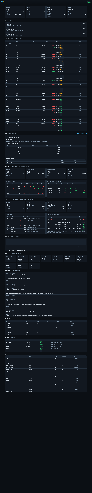

# EPIC · 个人市场分析工具

> **Economic Positioning, Intelligence & Cycles** —— 本地运行、以证据为中心的个人宏观—市场—交易决策工作台。
>
> 状态：**M0–M5 完成（v0.5）；M6 试运行支持工具就绪，等待真实使用与校准**（2026-11-09）。35 标的、3.9 万根日线、1.57 万条宏观观测；新增全球股指/LME、日德国债利率、DXY 日线、交易日志、周报、验收自动化；LLM 待 Key。



---

## 快速开始

```powershell
# 1) 初始化（自动引导 Python 3.12、创建 .venv、安装依赖、建库、写入种子数据）
powershell -ExecutionPolicy Bypass -File .\scripts\setup.ps1

# 2) 启动（后台会自动开始采集）
powershell -File .\scripts\start.ps1
```

浏览器打开 **http://127.0.0.1:8765**。

- 首次启动 30 秒内完成行情/利率/新闻的自动回补与入库（约 2.7 万根日线、9 千条利率观测）。
- 手动跑任务：`.\.venv\Scripts\python.exe -m app.jobs.runner --list` / `--job collect_quotes` / `--job brief_manual` / `--all`
- 生成简报：`--job brief_manual`，然后打开看板「每日简报」，或调用 `/api/briefs/latest`
- 证据链：点击任意新闻 → 正文弹窗 + 数字断言高亮；也可用 `http://127.0.0.1:8765/?doc=<document_id>` 深链
- 开发模式：`.\scripts\start.ps1 -Reload`
- 验收：`powershell -ExecutionPolicy Bypass -File .\scripts\check_acceptance.ps1`（跑测试 + 12 项 DoD）
- 备份：`.\scripts\backup.ps1` → `data/backup/<时间戳>/`
- 测试：`.\.venv\Scripts\python.exe -m pytest -q`

> 环境说明：系统 Python 为 3.8（过旧）。`setup.ps1` 会用 uv 在工作区内安装 **Python 3.12.16**（`.python/`），不修改系统环境。

---

## 已接入的数据（2026-11-09 实测）

| 数据 | 来源 | 覆盖 |
|---|---|---|
| 国内期货日线 | 新浪 | 黄金/白银/铜/铝/锌/镍/原油/豆粕/铁矿/白糖/棉花/棕榈油，各约 2000 根 |
| 国内期货实时 | 新浪 | 主力连续（价、涨跌、成交、持仓），约 3–60 秒 |
| A 股/指数 | 东方财富 | 沪深 300、洛阳钼业（日线 + 快照） |
| 外盘金银油铜 | 新浪 | 伦敦金银、COMEX 金银、WTI、Brent、LME 铜（约 15 分钟延迟，界面标注） |
| 汇率 | 新浪 | USDCNH/USDJPY/EURUSD/GBPUSD/USDCAD/USDSEK/USDCHF + 自算 DXY 代理 |
| 美元/人民币日线 | 东方财富 | DXY、USDCNH 各 2000 根（2019–2026），DXY 实时报价 |
| 全球股指 | 东方财富 | 标普500、纳指100、道琼斯、恒生（日线约 2000 根 + 实时） |
| LME 金属 | 新浪 | 伦铝/伦锌/伦镍实时（约 15 分钟延迟；无免费日线） |
| 美债利率 | 美国财政部 CSV | 2/5/10/30Y、5/10Y 实际利率、盈亏平衡通胀，近 5 年日频 |
| 日/德国债 | 日本财务省 / 欧洲央行 | JP2Y/10Y/30Y、DE2Y/10Y，近 4 年日频 |
| 新闻政策 | 官方 RSS/HTML | 美联储、欧洲央行、美国财政部（标题+元数据+原文快照） |

> 限制：Yahoo/CFTC/LME 国内直连 403；FRED 超时；BLS 403。对应替代与后续方案见 [05 数据源](docs/05-数据源与接口清单.md)、[07 开发进度](docs/07-开发进度.md)。

---

## 它要解决什么

把「信息汇聚 → 证据固化 → 因果分析 → 情景推演 → 交易计划 → 复盘校准」做成可重复的流水线：

- **信息**：多源汇聚、事件聚类、原文快照与可信度评分；
- **分析**：经济周期定位、资产定价分解、跨市场传导、参与者行为、历史类比；
- **取证**：每条结论可溯源到原文片段、时间与来源，矛盾并列不隐藏；
- **决策**：面向国内期货与 A 股的交易计划（方向、价位、仓位、止损、时间止损、失效条件）；
- **复盘**：预测登记、Brier 校准、信号回测、交易日志与纪律分。

覆盖重点：黄金/白银、原油、铜铝锌镍、内外盘同品种、美元与日元/人民币、美债与中日欧利率、美股与 A 股（有色金属，洛阳钼业为个股模板）。**不覆盖国内独有品种**，V1 不接自动下单。

---

## 文档索引

| 文档 | 内容 |
|---|---|
| [01 需求分析与产品定义](docs/01-需求分析与产品定义.md) | 背景、痛点、范围、功能/非功能需求、验收标准 |
| [02 系统架构设计](docs/02-系统架构设计.md) | 分层架构、数据模型、采集适配、LLM 编排、前端、部署 |
| [03 分析框架与模型设计](docs/03-分析框架与模型设计.md) | 周期/定价/传导/参与者/历史类比/证据可信度/交易系统 |
| [04 实施方案与里程碑](docs/04-实施方案与里程碑.md) | M0–M6 里程碑、WBS、关键路径、测试、风险 |
| [05 数据源与接口清单](docs/05-数据源与接口清单.md) | 免费/付费数据源、实测可用性、降级链、合规 |
| [06 示例输出：黄金分析](docs/06-示例输出-黄金分析.md) | 简报/计划卡/证据链样例 |
| [07 开发进度](docs/07-开发进度.md) | 已完成、问题与修复、下一步 |
| [08 使用手册](docs/08-使用手册.md) | 安装、每日流程、任务表、配置、API、排障、验收 |
| [09 试运行与验收](docs/09-试运行与验收.md) | DoD 对照、M6 计划、安全合规、容量、V1.1 清单 |

---

## 架构一览

```
浏览器 (静态看板 → M2 起 React)
   │ HTTP 127.0.0.1:8765
FastAPI (api / SSE / 导出)
   │
├─ 采集适配层  sina / eastmoney / treasury / rss（限速、重试、快照、健康）
├─ 知识层      documents / claims / events / theses / evidence（M2）
├─ 分析层      regime / pricing / correlation / analog / sentiment（M3）
├─ 决策层      signals / plans / risk / backtest / predictions（M4）
├─ LLM 编排    DeepSeek（M2）
└─ 存储        SQLite + DuckDB/Parquet + 文件快照
```

技术栈：Python 3.12 + FastAPI + SQLAlchemy + APScheduler + DuckDB；前端 React/TS/ECharts（M2 起）；数据源见 [05](docs/05-数据源与接口清单.md)。

---

## 里程碑

| 阶段 | 交付 | 状态 |
|---|---|---|
| M0 | 环境、骨架、数据库、调度器、健康检查、看板 | ✅ 完成 |
| M1 | 行情/宏观/新闻接入 + 多源降级 + 数据看板 | ✅ 完成（CZCE 对账、数据质量已补；经济日历待补） |
| M2 | 证据链、可信度、每日简报 v1 | ✅ 基础完成（规则抽取 + 证据链 UI + 简报 v1；LLM 抽取待 Key） |
| M3 | 周期/定价/关联/类比/参与者分析 | ✅ v0 完成（周期/归因/相关性/风向/类比；传导图与持仓待补） |
| M4 | 信号、情景、交易计划、风控、回测、预测账本 | ✅ 完成（v0.1：合约乘数/手数/保证金/手续费、成本回测、预测对账） |
| M5 | 告警、导出、系统页、性能、文档、安全 | ✅ 完成（v0.2：通知渠道、打印/PDF、LLM 接入、复核 API、验收文档） |
| M6 | 两周试运行与校准 | 🟡 支持工具就绪（交易日志/周报/验收/日线补齐），待真实使用 |

---

## 目录

```
backend/app/        FastAPI 应用（api / ingest / jobs / platform / models）
web/                零构建看板（M2 换 React）
config/             默认配置（关注清单、宏观序列、新闻源、LLM）
docs/               设计与进度文档（含看板截图）
scripts/            setup / start / backup
tests/              pytest（解析器离线测试 + smoke）
data/               运行时数据（gitignore）
```

---

*本系统仅供个人研究与决策辅助，不构成投资建议。*
