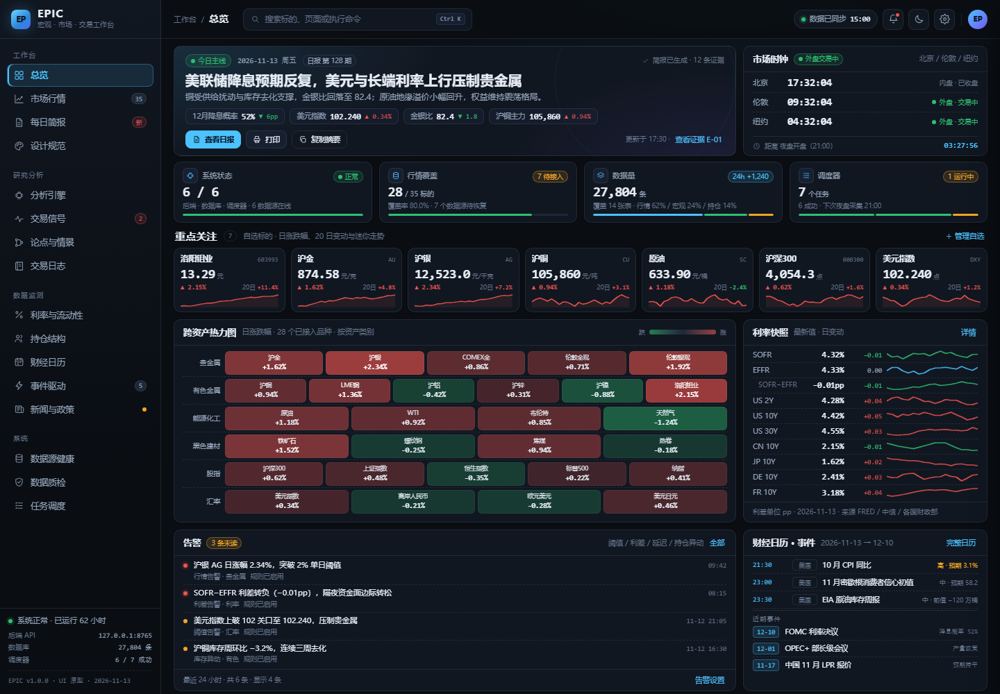
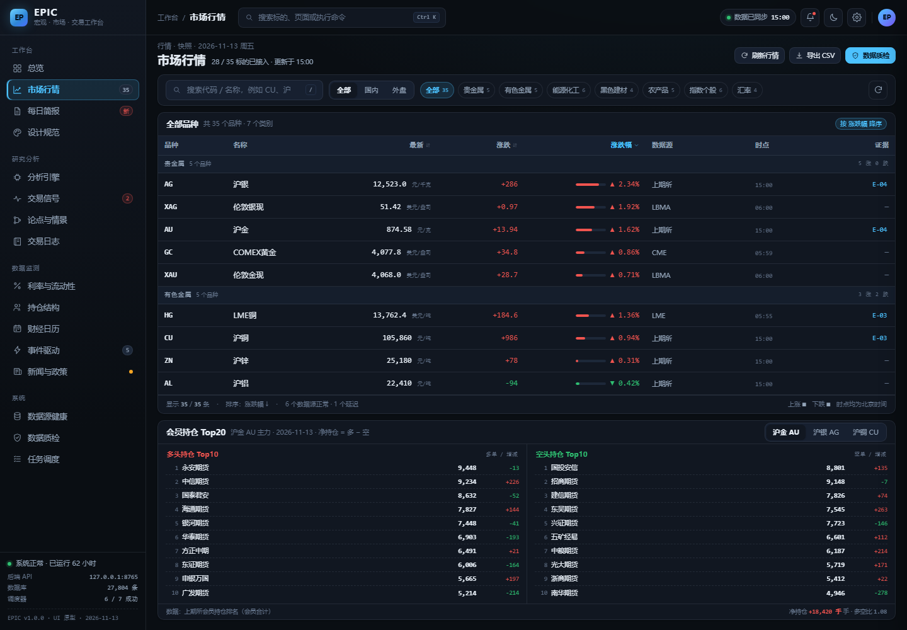
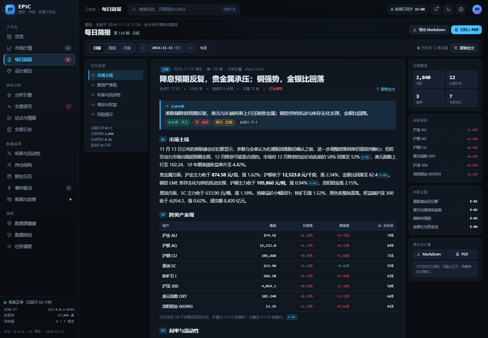
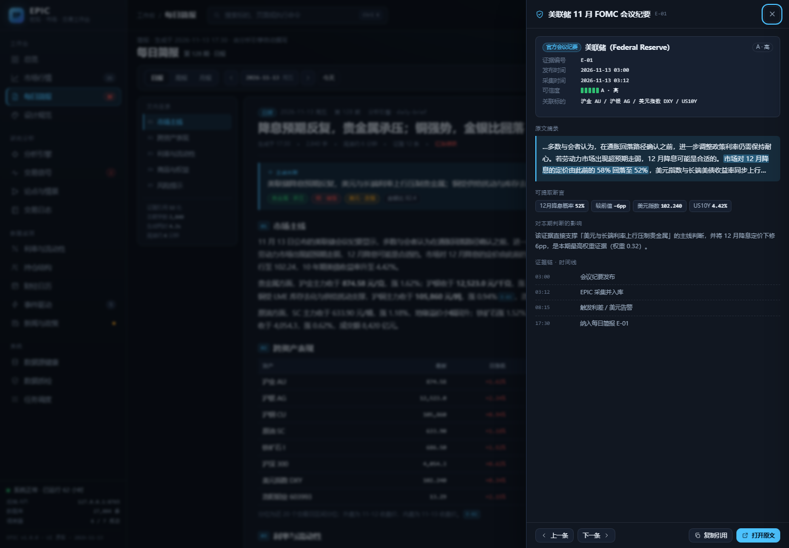
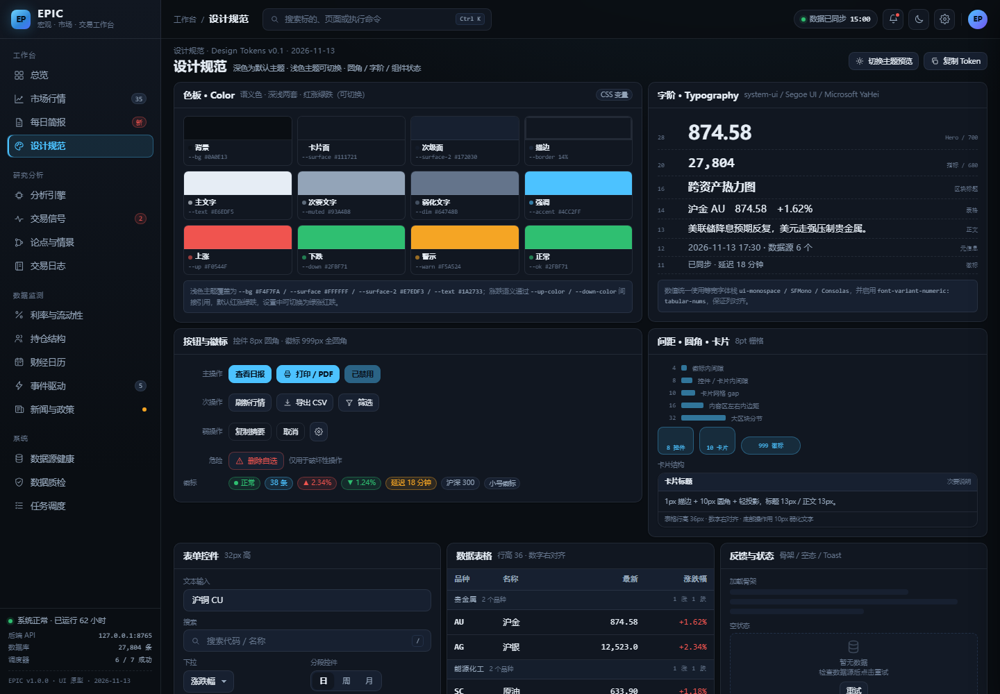
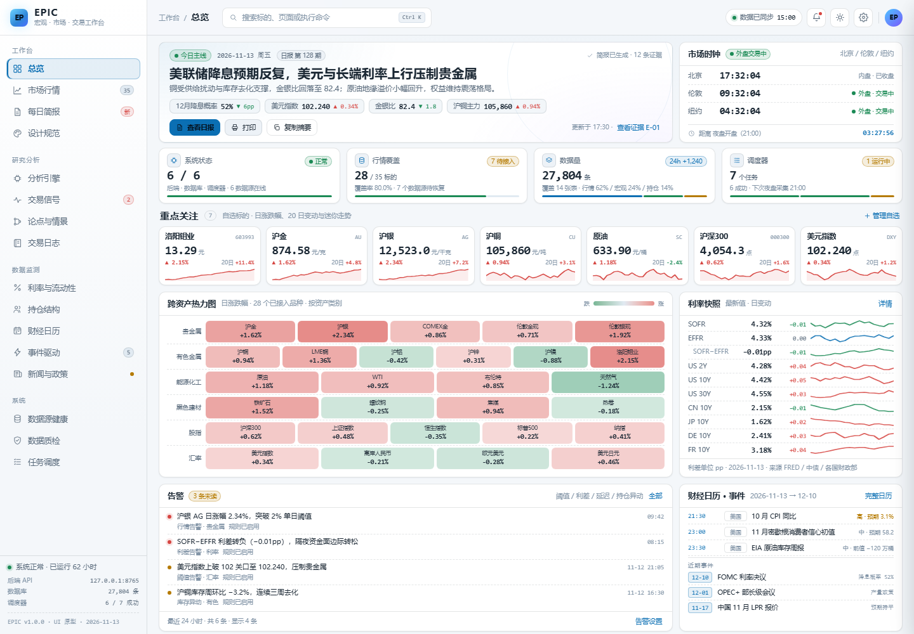

# 15 · 项目整理与前端（Vue）改造方案

> 状态：**已确认并实施完成**（2026-11-14，V1.1.0）。本文档保留原始方案与实施结果（§9）。
> 日期：2026-11-14 · 目标版本：V1.1.0（前端重构）· 关联：[02 系统架构 §11](02-系统架构设计.md)、[07 开发进度](07-开发进度.md)、[README](../README.md)

---

## 0. 一页摘要

**扫描结论**：后端（FastAPI + SQLite，约 50 个模块）与数据链路完整、测试 106 条通过；前端是**单文件 `web/index.html`（1,700 行 / 89 KB，原生 JS）**，18 个区块纵向堆成一页，全部数据靠 `setInterval` 轮询 + `innerHTML` 拼接，无路由、无构建、无组件化。数据目录 `data/` 已膨胀到 **577 MB / 12,449 个文件**，其中约 **400 MB 是可再生的临时产物**（Chrome 截图 profile、临时截图、pytest 临时目录）。

**三件事**：

| 事项 | 方案 | 状态 |
|---|---|---|
| 文件整理 | 清理可再生临时产物（先 dry-run 出清单再删）；`data/raw` 原文快照加 30 天保留策略；新增 `scripts/maintain.ps1` 防复发 | **已完成安全清理 300.6 MB / 9,429 文件**（见 §2.7）；`data/raw` 裁剪待确认 |
| 前端改造 | Vue 3 + TypeScript + Vite 重写；单页 → **侧边栏 + 路由 8 个页面**；自建设计系统（深色终端风）+ ECharts；保留全部 31 个 API 端点与现有功能 | **已完成**（§9；过渡期旧版 `/legacy` 已于 V1.3 收尾时删除） |
| 交付确认 | **UI 静态原型 + 5 张截图**（§3.8）与本文档，确认风格/技术栈/信息架构后再动工 | 已确认，已按方案实施 |

**需要你拍板的 4 件事**（详见 §8）：① UI 风格方向 ② 技术栈组合 ③ 页面信息架构 ④ 文件清理范围。

---

## 1. 项目全量扫描

### 1.1 技术栈与规模

| 层 | 现状 |
|---|---|
| 后端 | Python 3.12.16（工作区 `.python/`）+ FastAPI + SQLAlchemy + APScheduler + SQLite（`data/epic.db` 50 MB）+ DuckDB/Pandas |
| 前端 | **零构建**：`web/index.html` 单文件，内联 CSS + 原生 JS；主题用 CSS 变量（dark/light/sepia + 红绿/绿红）；手写 SVG 折线图 |
| 数据 | 35 标的 / 4.2 万根日线 / 1.8 万条利率观测 / 2,500+ 日历 / 13 品种会员持仓 / 194 篇官方新闻 |
| 工程 | `scripts/lint.py`（静态检查）+ pytest 106 条 + `.github/workflows/ci.yml`（3.11/3.12）+ `scripts/start|stop|restart|backup|restore|selfcheck|check_acceptance` |
| 版本 | `1.0.0-rc1`（`backend/app/__init__.py` 单一来源，`test_release.py` 校验一致性） |
| 运行时 | Node v22.23.4；npm 8.19.1（需用 `npm.cmd`，`npm.ps1` 被执行策略拦截）；当前 npm registry 指向已停服的 `registry.npm.taobao.org`，**须改为 `https://registry.npmmirror.com`（已实测可用）** |

### 1.2 目录与体量（扫描时实测）

| 目录 | 文件数 | 体量 | 说明 |
|---|---:|---:|---|
| `backend/` | 177 | 0.9 MB | FastAPI 应用（api/ingest/analytics/decision/narrative/platform/models） |
| `web/` | 1 | 0.1 MB | 仅 `index.html`（1,700 行） |
| `tests/` | 58（含 `__pycache__`） | 0.4 MB | 29 个测试文件 / 106 条（`pytest --collect-only` 实测） |
| `docs/` | 56 | 25.3 MB | 14 篇设计文档 + 42 张截图（累计截图占 24 MB） |
| `scripts/` | 12 | — | setup/start/stop/restart/backup/restore/ci/selfcheck/check_acceptance/lint |
| `config/` | 1 | 6 KB | 标的、自选、宏观序列、新闻源、LLM |
| `data/` | **12,449** | **577 MB** | 见 §1.3，其中大量可再生临时产物 |
| `.cache/` | 5,876 | 180.7 MB | uv 缓存（可再生） |
| `.venv/` `.python/` `.tools/` | 6,629 / 3,441 / 18 | 182.2 / 62.2 / 31.8 MB | 运行环境（不可删） |
| **合计** | **29,851** | **1,086 MB** | 首次安装/启动后可接受，但 `data/` 需整理 |

### 1.3 `data/` 现状（整理的重点）

| 路径 | 体量 | 内容 | 性质 |
|---|---:|---|---|
| `data/chrome-*`（49 个目录） | **286.2 MB** / 9,295 文件 | 历次截图用的 Chrome user-data-dir（`chrome-profile1..34`、`chrome-theme-*`、`chrome-brief-*` 等） | **可再生产物**，无代码/文档引用 |
| `data/raw/` | 110.7 MB / 3,117 文件 | 采集原始报文快照（欧洲央行/日本央行 RSS XML，按来源/日期分目录） | **证据链依赖**（`raw_path` 入库），需保留策略 |
| `data/backup/` | 108.7 MB / 6 文件 | 数据库备份（已有 14 份保留策略） | 核心，保留 |
| `data/*.png`（12 个） | ~10 MB | 调试截图（`full-brief.png`、`m10-preview.png` 等） | 与 `docs/assets/` 重复，可删 |
| `data/logs/` | 5.8 MB / 8 文件 | 服务与任务日志（`server.out/err.log`、`m*.log`、`app.log`） | 运行时产物，需轮转 |
| `data/epic.db` + wal/shm | 55 MB | 核心 SQLite | 核心，保留 |
| `data/test/` | 1.2 MB | pytest `--basetemp` 产物（含 1 个测试库） | 临时，可删 |
| `data/scratch/`、`data/run/epic.pid` | — | 调试残留（`t-TRUNCATE.db-journal`、**过期 PID 文件**：8765 当前未监听） | 可删 |
| `data/chrome-profile/` | 0 | 空目录 | 可删 |

其它发现：仓库内有 **289 个 `__pycache__` 目录**（`.venv/.python` 内属正常，`backend/` 下为再生缓存）；无 `.pytest_cache`；根目录无杂散文件；`data/` 下 55 个目录中 49 个是 Chrome profile。

### 1.4 前端依赖的 API（实际调用 31 个端点 + 2 个备选，改造后契约不变）

| 模块 | 端点 |
|---|---|
| 系统 | `/api/system/health`、`/jobs`、`/meta`、`/data-quality`、`/acceptance`、`/sources` |
| 市场 | `/api/market/snapshot`、`/market/bars`、`/macro/latest`、`/macro/series`、`/positions`、`/positions/members` |
| 信息 | `/api/news`、`/documents/{id}`、`/documents/{id}/evidence`、`/claims`、`/events`、`/calendar` |
| 简报 | `/api/briefs/latest`、`/briefs/{id}`、`/briefs/{id}/print`（HTML）、`/briefs/{id}/markdown` |
| 分析 | `/api/analytics/overview`（内含 wind/regimes/correlation/attribution/analogs/calendar_study） |
| 决策 | `/api/decisions/summary`、`/decisions/review` |
| 论点 | `/api/theses`、`/theses/{id}`（PATCH）、`/theses/review` |
| 自选 | `/api/watchlist`（GET/POST）、`/candidates`、`/reorder`、`/{symbol}/move`、`/{symbol}`（DELETE） |
| 其它 | `/api/alerts`、`/api/alerts/{id}/ack`、`/api/journal`（GET/POST） |

统一响应 `{data, meta}`（meta 含 `asof/source/delay_sec`）；错误为 HTTP 4xx/5xx。**后端无需改 API**，仅需加 SPA 回退路由。

### 1.5 现有前端问题清单

| 级别 | 问题 | 影响 |
|---|---|---|
| P0 | 单文件 1,700 行，HTML/CSS/JS 混排，`innerHTML` 字符串拼接 20+ 处 | 无法维护，XSS 面（虽有 `esc`），改一处牵全身 |
| P0 | 无路由：18 个区块堆在一页，首屏要等 19 个请求返回大部分内容才算完整 | 首屏慢、信息无层次、找不到东西 |
| P0 | 无构建/依赖管理/"组件"，样式靠全局类 + 行内 style | 无法沉淀设计系统，改版成本高 |
| P1 | 图表为手写 SVG（1,000 行里近 150 行画线），无缩放/十字光标/多序列 | 图表能力弱，K 线/热力图做不了 |
| P1 | `onclick` 内联事件 + 字符串传参（`openHistory('instrument','AU','沪金')`） | 转义脆弱、无法静态校验 |
| P1 | 无骨架屏/空态规范，加载态是"加载中…"文本 | 观感与体感差 |
| P1 | 每 15s 全量重拉 health/quotes/jobs；编辑自选时轮询与本地排序互相打架（`watchEditMode` 绕过） | 无谓请求、拖拽抖动 |
| P2 | 无快捷键、无搜索、无深链（仅 `?doc=`/`?history=` 等少数参数） | 高频操作效率低 |
| P2 | 弹框/DOM 手写（`classList.add("open")`），无焦点管理/ESC 关闭 | 可访问性弱 |
| P2 | 测试只做"字符串存在性"断言（`test_ui_static.py`/`test_theme.py` 在 HTML 里 grep id 和函数名） | 对 Vue 改造完全失效，必须重写 |

### 1.6 质量门禁现状（改造必须同步更新）

- `scripts/lint.py::check_frontend()`：读 `web/index.html`，校验 id 唯一、`$("id")` 有对应元素、`onclick` 处理函数已定义、用 `node --check` 校验内联 JS 语法。→ Vue 化后此检查失效，需改为"前端构建产物 + 类型检查"。
- `tests/test_theme.py`、`tests/test_ui_static.py`：直接读 `web/index.html` 断言字符串。→ 需改为读构建产物或迁移为 E2E/单元测试。
- `tests/test_release.py`：校验版本一致、lint/CI 存在。→ 版本升级需同步 `pyproject.toml` 与 `backend/app/__init__.py`。
- `.github/workflows/ci.yml`：仅 Python 矩阵，无 Node 步骤。→ 需加 `setup-node` + `npm ci` + `npm run build`（或在 lint 中校验产物存在）。

---

## 2. 文件整理方案

### 2.1 判定原则

1. **核心数据不动**：`data/epic.db*`、`data/backup/`、`config/`、`data/raw/`（证据链需要）。
2. **可再生即删**：截图用 Chrome profile、调试 PNG、pytest 临时目录、过期 PID、`__pycache__`。删除前先 dry-run 输出清单，删除后仍可从 git 之外重新生成。
3. **需要"规范化"而非删除**：`data/raw/` 加保留期、`data/logs/` 加轮转、截图统一进 `docs/assets/`。
4. **防复发**：`.gitignore`、维护脚本、lint 检查三件套，避免下次再长回 400 MB。

### 2.2 清理清单（预计释放 ~400 MB / 9,300+ 文件）

| 路径 | 体量 | 动作 | 依据 |
|---|---:|---|---|
| `data/chrome-*`（49 个目录） | 286 MB | **删除** | 截图为一次性 user-data-dir；全仓库无引用（已 grep 验证）；删后截图可重建 |
| `data/raw/` 中 30 天以前的分目录 | 约 100 MB（视窗口） | **保留最近 30 天，其余清理** | 证据链只需近期原文；`raw_path` 为相对路径，超期记录仍留在 DB（只影响回看旧原文） |
| `data/test/tmp/`、`data/test/m0/` | 1.2 MB | 删除 | pytest 每次再生 |
| `data/scratch/` | 1 文件 | 删除 | 调试残留 |
| `data/*.png`（12 个） | 10 MB | 删除 | 与 `docs/assets/m*.png` 重复；如需保留先归档 |
| `data/run/epic.pid` | 1 文件 | 删除 | 过期 PID（端口未监听，会导致 `start.ps1` 误判，建议 start 脚本自身也做 PID 活性校验） |
| `data/logs/*.log` | 5.8 MB | 归档后截断（保留最近 7 天） | `server.out/err.log` 是排障依据，不能全删 |
| `backend/**/__pycache__` | 若干 | 删除 | Python 再生 |
| `data/chrome-profile/`（空目录） | 0 | 删除 | — |

> 已确认：`chrome-*`、`data/*.png`、`czce_holding.xlsx` 等在工作区代码/脚本/文档中**零引用**，删除不影响 `lint`/`pytest`/启动。

### 2.3 保留与规范化

| 对象 | 策略 |
|---|---|
| `data/raw/` | 新增 `data.raw_retention_days: 30`（`config/default.yaml`），采集时/维护任务按来源目录清理超期文件；保留"每个来源最近 N 份"兜底 |
| `data/backup/` | 维持现有 14 份策略（`backup.py` 已实现），保留 |
| `data/logs/` | `scripts/maintain.ps1` 按天归档并保留 7 天；或改用 `RotatingFileHandler`（后端小改） |
| 截图 | 一律存 `docs/assets/`，命名 `功能-视图.png`；禁止再往 `data/` 落 |
| pytest | 维持 `--basetemp=data/test/tmp`，维护脚本清理 |

### 2.4 改造后目录结构（新增/变化标 ★）

```
economic-analysis-tool/
├─ backend/app/                 FastAPI（仅 main.py 增加 SPA 回退；可选 log 轮转）
├─ frontend/                ★  Vue 3 + TS + Vite 源码（新增）
│  ├─ src/{api,components,composables,layouts,router,stores,styles,views}
│  ├─ index.html            ★  Vite 入口
│  ├─ vite.config.ts        ★
│  ├─ package.json / tsconfig.json / .npmrc（registry=npmmirror）
│  └─ .eslintrc / env.d.ts
├─ web/                     构建产物（Vite outDir）：index.html + assets/*（*.js、*.css）
│  └─ index.legacy.html   ★  过渡期保留旧版（P6 删除）
├─ scripts/                 新增 ★ dev.ps1、build.ps1、maintain.ps1
├─ docs/                    新增 ★ design/（UI 方案与原型截图）、15-前端改造方案.md
├─ data/                    只保留 DB/备份/日志/raw(30天)/run
└─ tests/                   新增 ★ test_frontend_build.py；改写 test_theme/test_ui_static
```

### 2.5 防复发

1. `.gitignore` 增加：`data/chrome-*/`、`data/*.png`、`frontend/dist/`、`.vite/`、`*.tsbuildinfo`。
2. `scripts/maintain.ps1 -DryRun`：输出待清理清单（体量/数量/最后修改时间）→ 加 `-Apply` 才执行。
3. `scripts/lint.py` 增加"工作区卫生"检查：`data/` 体积 > 900 MB 或出现 `data/chrome-*` 时 warn。
4. `scripts/start.ps1` 读取 PID 前校验进程活性，避免过期 PID 误判（顺带修复本次发现的隐患）。

### 2.6 执行顺序与回退

```
1) maintain.ps1 -DryRun  → 产出清单，人工确认
2) git status 确认工作区干净（data/ 均已 ignore，不产生 diff）
3) maintain.ps1 -Apply   → 逐类删除并打印释放量
4) 重启服务 → /healthz 200、看板可用、`maintain.ps1 -Verify` 复查
5) 如误删：截图/临时目录可再生；data/raw 超期文件如需找回可从来源重采
```

### 2.7 执行记录（2026-11-14）

| 项 | 结果 |
|---|---|
| 新增脚本 | `scripts/maintain.ps1`（`-DryRun` 默认 / `-Apply` / `-Verify` / `-IncludeRaw` / `-IncludeLogs`；UTF-8 BOM，PS 5.1 与 pwsh 7 兼容） |
| DryRun | 75 项 / 9,429 个文件 / **300.6 MB**（49 个 Chrome profile、12 张临时 PNG、pytest 临时目录、14 个 `__pycache__`、过期 PID、scratch 残留） |
| Apply | 释放 **300.6 MB / 9,429 个文件**；`data/` 从 577 MB / 12,449 文件 → **277.3 MB / 3,135 文件** |
| Verify | 残留 `chrome-*`：0（空目录也清掉）；`data/*.png`：0；`epic.db` / `backup` / `raw` / `logs` 均在 |
| 回归 | `scripts/lint.py` 0 error 0 warning；`pytest -q` **106 passed**（6.17s） |
| 待确认 | `data/raw` 30 天裁剪（约 100 MB）与日志 7 天轮转默认未执行，需加 `-IncludeRaw` / `-IncludeLogs` 或确认后纳入定时任务 |

---

## 3. UI 改造方案

### 3.1 设计原则

1. **决策工作台，不是数据大屏**：首屏回答"今天主线是什么、我的自选怎样、有无异常"。
2. **专业终端质感**：深色为默认，高信息密度但严格对齐（4px 栅格、等宽数字、统一行高）。
3. **渐进披露**：总览看结论 → 页面看明细 → 抽屉看原文证据；三层各自成立。
4. **状态即语言**：延迟 15m / 旧数据 / 失败 / 降级，用统一徽标与色阶表达，不靠文字解释。
5. **键盘优先 + 可回退**：Ctrl/⌘+K 命令面板、ESC 关浮层、主题/涨跌色浏览器本地持久化。

### 3.2 信息架构（18 个区块 → 8 个页面 + 全局浮层）

| 路由 | 页面 | 承载现有模块 |
|---|---|---|
| `/` | **总览** | 4 个 KPI、今日主线（简报摘要）、市场时钟、自选卡、跨资产热力图、利率快照、告警、今日日历 |
| `/market` | **市场** | 市场快照（外盘/国内分段、按 TE 类别分组、搜索/排序）、持仓结构、会员 Top20 |
| `/rates` | **利率与流动性** | 22 条宏观序列（按美/日/德/法/中分组）、SOFR-EFFR 利差、历史趋势图 |
| `/analysis` | **分析引擎** | 风向/周期/相关性卡片、定价归因、历史类比、日历事件后收益 |
| `/signals` | **决策** | 信号、交易计划（含风控校验）、信号回测、预测校准 |
| `/theses` | **论点与证据** | 论点卡（后验/情景/失效条件）、论点复核、事件驱动流；新闻/证据抽屉（全局） |
| `/briefs` | **简报** | 日报/周报/月报阅读器（TOC、打印/PDF、导出 Markdown）、交易日志 |
| `/system` | **系统** | 服务状态、任务表、数据源健康、数据质检、验收自检、版本/环境 |
| 全局 | 命令面板、证据抽屉、设置抽屉、告警 toast | 顶栏 / 快捷键 / 上下文 |

侧边栏分组：**概览**（总览）｜**市场**（市场 / 利率）｜**研究**（分析 / 论点与证据）｜**决策**（决策）｜**内容**（简报 / 日志）｜**系统**。

### 3.3 布局系统

- 左侧固定侧边栏 232px（可折叠至 64px 图标栏）；顶栏 56px 吸顶：页面标题、全局搜索（Ctrl+K）、多市场时钟（北京/伦敦/纽约）、服务状态徽标、主题、设置。
- 内容区最大 1600px，24px 边距；栅格 12 列，卡片间距 16px；表格行高 36px（紧凑）/ 44px（宽松，可切换密度）。
- 断点：≥1440 三列，1024–1440 两列，<768 单列 + 侧边栏抽屉化（移动端只保证"可读"，不作为主场景）。
- 打印：简报页单独 `@media print` 版式（去侧栏/顶栏、白底黑字、表格边框、页眉页脚）。

### 3.4 设计 Token（深色默认 / 浅色覆盖）

| 类别 | 值 |
|---|---|
| 背景 | `--bg #0A0E13`、`--surface #111721`、`--surface-2 #172030`、`--surface-3 #1D2838` |
| 边线 | `--border rgba(148,163,184,.14)`（浅色 `#E7EDF3`） |
| 文字 | `--text #E6EDF5`、`--muted #93A4B8`、`--dim #64748B` |
| 强调 | `--accent #4CC2FF`（品牌延续）、`--accent-soft rgba(76,194,255,.12)` |
| 涨跌 | `--up #F0544F` / `--down #2FBF71`（默认红涨绿跌，设置可切绿涨红跌） |
| 状态 | `--ok #2FBF71`、`--warn #F5A524`、`--bad #F0544F`、`--info #4CC2FF` |
| 字体 | 正文 `system-ui, "Segoe UI", "Microsoft YaHei"`；数值/代码 `ui-monospace, "JetBrains Mono", Consolas`；数字 `font-variant-numeric: tabular-nums` |
| 字阶 | 11 徽标 / 12 元信息 / 13 正文 / 14 表格 / 16 区块标题 / 20 卡片指标 / 28 hero 指标 |
| 间距 | 4 / 8 / 12 / 16 / 24 / 32（4px 栅格） |
| 圆角 | 卡片 10px、控件 8px、徽标 999px |
| 阴影 | 卡片 `0 1px 0 rgba(255,255,255,.03) inset` + `0 8px 24px rgba(0,0,0,.25)`；浮层 `0 24px 64px rgba(0,0,0,.5)` |

主题：`dark`（默认）/ `light` / 跟随系统，`localStorage` 持久化；`?theme=`/`?updown=` 深链参数保留（测试与截图脚本依赖）。

### 3.5 组件清单（自建，约 15 个）

`AppShell`（侧栏+顶栏）｜`PageHeader`｜`KpiTile`｜`DataTable`（排序/分组行/sticky 表头/空态/骨架）｜`PriceCell`（数值+涨跌色+单位）｜`Badge`（ok/warn/bad/info/delay）｜`Card`/`SectionCard`｜`Sparkline`（SVG 迷你走势）｜`Chart`（ECharts 封装：折线/面积/K线/热力）｜`Drawer`（证据/设置）｜`Modal`｜`CommandPalette`｜`SegmentedControl`｜`FilterChips`｜`Toast`/`Skeleton`/`EmptyState`｜`WatchlistCard`（拖拽）｜`BriefRenderer`（Markdown→富文本+涨跌着色+证据链接）。

图标：`lucide-vue-next`（内联 SVG，无图标字体）。图表：ECharts 5 + `vue-echarts`（按需引入，控制体积）。

### 3.6 关键交互

| 交互 | 行为 |
|---|---|
| 命令面板 `Ctrl/⌘+K` | 模糊搜索页面/标的名；回车跳转；`Esc` 关闭；`?doc=<id>` 深链直接搜文档 |
| 证据抽屉 | 点击任意新闻/`[证据]`/断言 → 右侧 480px 抽屉：标题、来源、时间、可信度、正文 + 断言高亮 `mark`；支持"上一条/下一条"、复制引用、打开原文 |
| 自选拖拽 | 编辑模式下拖拽排序（SortableJS），保存一次性 `POST /reorder`；编辑期间暂停该模块轮询 |
| 轮询与刷新 | 每个模块独立 `usePolling`（间隔沿用现值：行情/任务 15s，宏观/新闻 60s，分析 120s，持仓/日历 300s）；页面不可见时暂停（`visibilitychange`）；顶栏显示"最近刷新时间 + 手动刷新" |
| 主题/涨跌色 | 设置抽屉切换，本地持久化，图表与表格色同步 |
| 加载/降级 | 骨架屏 → 数据；单接口失败只影响该卡片（`ErrorState` + 重试），不拖垮整页 |
| 打印 | 简报页 `@media print`；`/api/briefs/{id}/print` 保留为备用 |

### 3.7 图表策略

| 场景 | 图型 | 交互 |
|---|---|---|
| 历史趋势（自选/快照/利率） | ECharts `line`/`area`，1月/3月/6月/1年/2年/5年/全部 | 十字光标、tooltip、区间缩放、高低点标注 |
| 跨资产热力图 | `treemap` 或自定义色块网格 | hover 显示涨跌幅/来源/时点，点击进资产 |
| 利率曲线 | 多序列折线（可选叠加） | 图例切换国家、期限结构视图（V1.1 可选） |
| K 线（后续） | `candlestick` + 成交量 | 预留资产详情页（P5+，本次不阻塞） |
| 迷你走势 | 自绘 SVG `Sparkline`（轻量，避免每卡一个 ECharts 实例） | hover 高亮 |

### 3.8 视觉原型（确认用）

静态原型（自包含、离线打开）：`docs/design/mockup/index.html`

| 视图 | 截图 |
|---|---|
| 总览（深色，默认） |  |
| 市场 |  |
| 简报 |  |
| 证据抽屉 |  |
| 设计规范 |  |
| 总览（浅色对比） |  |

> 原型：`docs/design/mockup/index.html`（单文件、离线、零外链），说明见 `docs/design/mockup/README.md`。已实现：侧边栏/命令面板/URL 视图切换、深浅主题与红涨绿跌切换、界面密度切换、外盘/国内分段与类别筛选、表头排序、证据抽屉（`?open=evidence`）、设置抽屉、Ctrl+K 命令面板、Toast、简报打印样式与 Markdown 导出。**原型仅用于确认视觉与交互方向**，不是最终代码；最终实现为 Vue 组件（布局与 token 保持一致）。

### 3.9 响应式与可访问性

- 1024/1440 两档为主要验收宽度；<768 侧边栏抽屉化、表格横向滚动、卡片单列。
- 所有浮层支持 `Esc`、点击遮罩关闭、焦点回到触发元素；表格/图表提供 `aria-label`；正文对比度 ≥ 4.5:1。

### 3.10 原型与最终实现的已知差异（实施时按此收敛）

| 项 | 原型 | 最终实现 |
|---|---|---|
| 会员持仓 | 每榜 Top10（共 20） | 按后端 `limit=20` **每榜 Top20**，区域内滚动，保留"净持仓/多空比" |
| 主题选项 | 深/浅 + `?theme=` 覆盖 | 增加 **跟随系统（auto）**，与原功能对齐；仍以深色为默认 |
| 「设计规范」入口 | 在侧边栏 | **仅开发模式可见**（`import.meta.env.DEV`），生产不展示 |
| 周报/月报正文 | 与日报同一示例 | 按 `kind` 请求 `/api/briefs/latest?kind=weekly`（或 `monthly`），无数据走空态 |
| 时钟 | 固定基准时间便于截图 | 使用后端 `health.time_local` + 本地真实时间，休市日显示"休市" |
| 未接入模块 | Toast 占位 | 全部接入真实页面（本项目 20 项功能无占位） |

---

## 4. 技术方案

### 4.1 技术栈选型

| 用途 | 选型 | 理由 | 备选 |
|---|---|---|---|
| 框架 | **Vue 3.5 + TypeScript + `<script setup>`** | 组合式 API 适合"取数+轮询+派生"模式；类型约束 API 响应 | — |
| 构建 | **Vite 6** | 秒级 HMR；`build.outDir ../web` 直接产出 FastAPI 可托管文件 | — |
| 路由 | vue-router 4 | 7 页面 + 深链参数（`?doc=`/`?theme=`） | — |
| 状态 | Pinia（仅全局偏好/设置/告警计数） | 页面级取数不进全局 store | 纯 composable |
| 取数 | 自研 `useApi`/`usePolling`（fetch 封装 + AbortController + 轮询） | 25 个接口、无缓存复杂需求，避免引入 TanStack Query 学习/体积成本 | `@tanstack/vue-query` |
| 图表 | ECharts 5 + vue-echarts（按需） | 折线/热力/K线一次到位，替换手写 SVG | Chart.js |
| 样式 | **Tailwind CSS + 设计 token（CSS 变量）** | 高频样式不用写 CSS 文件；token 与主题切换天然契合 | 纯 CSS Modules |
| 组件 | 自建 ~15 个基础组件 | 终端风需要完全控制；避免 UI 套件"后台管理味" | Naive UI（工期紧时） |
| 图标 | lucide-vue-next | 树摇、风格统一 | 内联 SVG |
| 工具 | @vueuse/core（`useEventListener`/`useIntervalFn`/`useMediaQuery`）、dayjs（时间） | 少造轮子 | — |
| 拖拽 | SortableJS（或 vuedraggable） | 自选排序 | 原生 HTML5 DnD |
| Markdown | markdown-it + DOMPurify | 简报/文档渲染，保留证据链接与涨跌着色 | — |
| 质量 | vue-tsc（类型检查）、ESLint（可选）、Vitest（可选，核心 composable 单测） | 与现有 pytest 门禁互补 | — |

> 全部依赖均可在 `registry.npmmirror.com` 安装（已实测 `npm view vue` = 3.5.45）。**前端不引入任何运行时 CDN**，离线环境可用。

### 4.2 前端目录结构

```
frontend/
├─ index.html                 # Vite 入口（title/lang/主题启动脚本防闪烁）
├─ vite.config.ts             # outDir=../web、dev proxy /api→127.0.0.1:8765、分包
├─ package.json / package-lock.json / tsconfig.json / .npmrc / .gitignore
└─ src/
   ├─ main.ts / App.vue
   ├─ api/           client.ts（fetch 封装）、types.ts（后端响应类型）、endpoints/*.ts
   ├─ composables/   usePolling.ts、useTheme.ts、useUpdown.ts、useToast.ts、useFormat.ts
   ├─ stores/        prefs.ts、alerts.ts
   ├─ router/        index.ts（7 页面 + 懒加载 + 深链 query）
   ├─ layouts/       AppShell.vue、Sidebar.vue、Topbar.vue
   ├─ components/    ui/*（Table/Card/Badge/Drawer/Modal/...）、charts/*、domain/*（WatchlistCard、BriefRenderer、EvidenceDrawer）
   ├─ styles/        tokens.css、base.css、print.css
   └─ views/         OverviewView、MarketView、RatesView、AnalysisView、SignalsView、ThesesView、BriefsView、SystemView
```

### 4.3 数据层约定

- `client.ts`：`get<T>(url)`/`post`，统一超时（10s）+ AbortController + 非 2xx 抛 `ApiError{status,url}`；`meta` 原样透传。
- 轮询表（集中配置，页面声明式使用）：`health/quotes/jobs 15s`、`macro/news/sources 60s`、`alerts/quality/acceptance 30s`、`analytics 120s`、`positions/calendar 300s`、`journal 120s`；`visibilitychange` 暂停。
- 数字/时间/单位格式化统一在 `useFormat.ts`（价格位数按资产类别、百分比带正负号、时区 `Asia/Shanghai`），禁止各视图各写一套。
- 错误：`ErrorState`（含重试）+ 顶栏全局"降级"徽标；接口失败不清空已有数据。

### 4.4 构建、托管与脚本

| 项 | 方案 |
|---|---|
| 构建 | `npm.cmd run build` → `frontend/` 内执行，`outDir: ../web`，`emptyOutDir: true`，`base: "/"`；产物 `web/index.html` + `web/assets/*` |
| 托管 | `main.py` 已挂 `/assets` 与 `/`；**新增** SPA 回退：`GET /{full_path:path}`（排除 `/api/*`、`/healthz`）返回 `web/index.html` |
| 开发 | `scripts/dev.ps1`：并行起 `uvicorn --reload`（8765）+ `vite dev`（5173，proxy `/api`） |
| 构建脚本 | `scripts/build.ps1`：`npm ci`（首次 `npm install`）→ `npm run build` → 校验 `web/index.html` 存在且含 `assets/` |
| 安装 | `scripts/setup.ps1` 追加前端依赖安装 + 首次构建（不破坏现有 Python 引导逻辑） |
| 门禁 | `scripts/ci.ps1` / `.github/workflows/ci.yml` 增加 Node 22 + `npm ci` + `npm run build`；`lint.py` 的 frontend 检查改为"产物存在 + 无外部 CDN + 入口引用校验"，删除失效的 id/handler 正则检查 |
| 测试 | 改写 `test_theme.py`/`test_ui_static.py` → `test_frontend_build.py`（产物存在、token 变量存在、无 `http://` 外链、`?theme=` 兼容）；新增 Vitest（可选）覆盖 `usePolling`/格式化 |
| 版本 | P6 统一升 `1.1.0`（`backend/app/__init__.py` + `pyproject.toml` + CHANGELOG） |

### 4.5 兼容与回退

- ~~旧版入口保留为 `web/index.legacy.html`（构建不覆盖该名），过渡期可通过 `/legacy` 打开；P6 验收通过后删除（git 历史仍可找回）。~~ → **V1.3 收尾已删除**：`web-legacy/`、`/legacy` 路由与旧看板一并移除（2026-11-17），需要时从 git 历史取回。
- 改造在分支 `feat/vue-frontend` 进行；每阶段 `lint + pytest` 必须通过；任何阶段可 `git checkout main` 回退。
- API 零改动；若需新增（如命令面板的全局搜索），仅"新增"不改旧契约。

---

## 5. 实施计划

| 阶段 | 交付 | 验收 | 预计 |
|---|---|---|---|
| **P0 文件整理** | `maintain.ps1`(dry-run/apply/verify)、清理 ~400 MB、`.gitignore`/`config` 保留策略、start PID 活性修复 | dry-run 清单与本文一致；服务重启正常；`data/` 降至 ~170 MB；lint+pytest 通过 | 0.5 天 |
| **P1 脚手架与设计系统** | `frontend/` Vite 工程、token/主题、AppShell（侧栏/顶栏/时钟/状态）、路由骨架、API 层、`usePolling`、build/serve/SPA 回退、`dev.ps1` | `npm run build` 产物可被 FastAPI 托管；空页面可导航；主题/涨跌色持久化；lint 改造通过 | 1 天 |
| **P2 总览 + 市场 + 利率** | 三页完整功能（KPI/主线/自选拖拽/热力图/快照表/持仓/利率分组/历史趋势图） | 与旧版逐项对照无缺失；数字/颜色/单位一致；轮询与降级正确 | 1.5 天 |
| **P3 分析 + 决策 + 论点** | 三页（风向/周期/相关性/归因/类比/日历研究；信号/计划/回测/校准；论点/情景/复核） | 数据与旧版一致；表格排序/空态/骨架屏 | 1.5 天 |
| **P4 信息与内容** | 证据抽屉、新闻/事件/日历、简报阅读器（打印/导出）、交易日志、命令面板 | 深链 `?doc=` 可用；打印版式正确；Markdown 证据链接可点 | 1 天 |
| **P5 系统页 + 打磨** | 系统页（服务/任务/数据源/质检/验收）、告警 toast/确认、移动端适配、可访问性、性能（路由懒加载、图表按需） | 首屏 < 2s（本地）；无 console 错误；键盘可达 | 1 天 |
| **P6 收尾** | 测试/CI/lint/文档/截图更新、品牌与 README、`legacy` 清理、版本 1.1.0 | `scripts/selfcheck.ps1` 全绿；CI 绿；文档截图更新 | 0.5 天 |

> 合计约 7 个工作日（按单 Agent 串行估算）；若由多 Agent 并行（如 P2/P3 分页面）可压缩到 3–4 天。每阶段结束向用户汇报可演示状态。

---

## 6. 验收标准

### 6.1 功能 Parity（旧版 18 个区块逐项可访问）

| # | 功能 | 验收点 |
|---|---|---|
| 1 | 系统状态/版本/LLM/时间 | 数值与 `/api/system/health` 一致 |
| 2 | 行情覆盖/数据量/调度器 | 同上，含任务数与错误数 |
| 3 | 告警列表 + 确认 | 确认后列表刷新，计数减 1 |
| 4 | 重点关注（自选） | 增/删/上移下移/拖拽排序落库；`watch_edit=1` 深链兼容 |
| 5 | 市场快照 | 外盘/国内分表、TE 类别顺序、延迟/旧数据徽标、点击看趋势 |
| 6 | 简报（日/周/月） | 弹窗或独立页；打印/PDF；导出 Markdown；`brief=` 深链 |
| 7 | 分析引擎 | 风向/周期/相关性/归因/类比/日历研究六块数据齐全 |
| 8 | 信号与计划 | 信号类型统计、计划风控徽标、回测两表 |
| 9 | 论点与情景 | 后验/情景概率/证据数/失效条件/复核文案 |
| 10 | 交易日志 | 保存后回显，条目倒序 |
| 11 | 利率与流动性 | 22 条序列、卡片点击趋势、1m–all 区间切换 |
| 12 | 持仓结构 + 会员 Top20 | 品种下拉切换，多空双表 |
| 13 | 财经日历 | 星标重要性、国家/类别 |
| 14 | 事件驱动 | 类型徽标、关联标的 |
| 15 | 新闻与政策 | 标题/元数据/原文抽屉、正文断言高亮、`?doc=` 深链 |
| 16 | 数据源健康 | 状态点/等级/条目数/最近检查 |
| 17 | 数据质检 | 通过/失败与明细 |
| 18 | 验收自检 + 任务表 | DoD 计数、任务 cron/状态 |
| 19 | 主题/涨跌色 | dark/light/sepia/auto + 红涨绿跌/绿涨红跌，刷新保持 |
| 20 | 打印 | 简报页打印无侧栏、白底、分页合理 |

### 6.2 工程门禁

- `python scripts/lint.py` 0 error；`pytest -q` 全绿（含改写后的前端测试）；`scripts/ci.ps1` 通过。
- `.github/workflows/ci.yml` 含 Node 构建步骤并通过（本地可用 `act` 或直接跑 build 校验）。
- 构建产物无外部 CDN 引用（`grep -r "http" web/assets` 仅允许 API/文档链接字符串）。
- 首屏 JS gzip < 350 KB（ECharts 按需后），路由懒加载分包。
- 无 `console.error`（开发模式告警除外）；无横向滚动条（1440 与 1024）。

### 6.3 文档与可回退

- 更新 README（目录、启动、前端开发命令）、CHANGELOG（V1.1.0）、`docs/02 §11`、`docs/07`；新增 `docs/design/` 原型与截图。
- `web/index.legacy.html` 删除前，旧版所有功能已验收。

---

## 7. 风险与对策

| 风险 | 影响 | 对策 |
|---|---|---|
| npm registry 指向已停服 taobao 源 | 装包失败 | 在 `frontend/.npmrc` 固定 `registry=https://registry.npmmirror.com`；脚本用 `npm.cmd` 绕开执行策略 |
| ECharts 体积大 | 首屏慢 | 按需引入（line/treemap/candlestick）+ 路由懒加载；Sparkline 用轻量 SVG |
| 改造期功能回退 | 数据看不了 | 保留 `legacy` 入口；每阶段 parity 对照；分支开发 |
| `lint.py`/旧测试失效 | 门禁形同虚设 | P1 即重写检查；CI 加 Node 构建，防"源码改了没构建" |
| 打印/PDF 版式 | 简报输出变形 | 独立 `print.css` + 用系统打印预览验收；保留 `/api/briefs/{id}/print` |
| 多 Agent 并行写冲突 | 文件互相覆盖 | 按页面/目录切分写入范围（views/ 各自独立文件），Lead 统一合并与跑门禁 |
| 用户已有自选/主题偏好 | 升级后丢失 | 主题/涨跌色沿用同一 `localStorage` key（`epic-theme`/`epic-updown`）；自选在数据库，不受影响 |

---

## 8. 待确认事项（已确认：全部按推荐方案 A 执行）

> 2026-11-14 用户确认「前端改造方案确认通过，请执行」：① UI 深色专业终端（A）② Vue3+TS+Vite+Pinia+Tailwind+ECharts 自建组件（A）③ 路由拆页（A，实际 8 页）④ 安全清理 + raw 30 天保留（A，raw 裁剪待确认执行）⑤ 版本升 1.1.0、移动端仅兜底。以下为原始待确认清单，保留备查。

| # | 问题 | 选项（推荐加粗） | 影响 |
|---|---|---|---|
| 1 | **UI 风格方向** | **A. 深色专业终端（本文 §3，原型见 §3.8）** / B. 深色更"数据大屏"（图表更大、信息更少）/ C. 明亮商务风 / D. 双主题并重 | 决定 P1/P2 的视觉工作量 |
| 2 | **技术栈组合** | **A. Vue3+TS+Vite+Pinia+Tailwind+ECharts（自建组件）** / B. Vue3+Naive UI（少写组件、后台管理味）/ C. React18+TS（沿用 docs/02 原始规划） | 决定依赖与工期 |
| 3 | **页面信息架构** | **A. §3.2 的路由拆页（实际落地 8 页）** / B. 保持单页但分区+侧栏锚点（改动小）/ C. 更多拆页（资产详情、新闻、计划独立） | 决定导航与拆页粒度 |
| 4 | **文件清理范围** | **A. 按 §2.2 安全清理（已完成 300.6 MB）** / B. 只删 Chrome profile 与临时文件 / C. 只出清单不删除 | 决定动手范围 |

> 另：是否顺带把版本升到 `1.1.0` 并写 CHANGELOG？（默认：是）／是否需要移动端专门适配？（默认：只保证可读）／是否需要添加"资产详情页"（K 线 + 归因 + 证据，P5 可选）？

---

*确认后按 §5 从 P0 开始实施；实施过程中每阶段提供可运行状态与截图。*

---

## 9. 实施结果（2026-11-14，V1.1.0）

### 9.1 交付物

| 项 | 位置 |
|---|---|
| 前端源码 | `frontend/`（Vue 3.5 + TS + Vite 6 + Pinia + vue-router + ECharts + Tailwind） |
| 构建产物 | `web/`（index.html + assets，由 FastAPI 托管，SPA 回退；**不入版本库**，由 `scripts/build.ps1` 生成） |
| 设计系统 | `frontend/src/styles/app.css`（深/浅/护眼/跟随系统、涨跌色、密度、打印） |
| 新脚本 | `scripts/build.ps1`、`scripts/dev.ps1`、`scripts/maintain.ps1` |
| 页面截图 | `docs/assets/vue/`（13 张） |
| UI 原型 | `docs/design/mockup/`（6 张预览图） |

### 9.2 页面与功能（8 页）

| 路由 | 页面 | 已实现要点 |
|---|---|---|
| `/` | 总览 | 今日主线、市场时钟、4 KPI、自选卡（迷你走势 + 自选管理）、热力图、利率快照、告警、日历 |
| `/market` | 市场行情 | 搜索/内外盘分段/类别 chips、分组表 + 排序、幅度条、持仓结构、会员 Top20、`?symbol=` 深链 |
| `/rates` | 利率与流动性 | 22 序列 5 组、SOFR−EFFR 利差卡、10 个主序列日变动 + 迷你走势、点击开历史 |
| `/analysis` | 分析引擎 | 风向/周期/相关性/归因/类比/日历研究/异动，单次 overview 请求 |
| `/signals` | 交易信号 | 指标卡、类型统计、信号表、计划表（风控/资金不足）、回测、校准 |
| `/theses` | 论点与证据 | 论点卡、复核；事件/新闻/日历 tabs；新闻点击开证据抽屉 |
| `/briefs` | 简报与日志 | 三栏阅读器、目录滚动高亮、Markdown 安全渲染、证据按钮、打印/导出、交易日志 |
| `/system` | 系统状态 | 服务/数据库/调度器/验收 KPI、任务、数据源、质检、DoD |

### 9.3 交互与兼容

- 命令面板 `Ctrl/⌘+K`；`Esc` 关闭浮层；`/` 聚焦搜索。
- 证据抽屉（原文 + `mark` 高亮 + 断言 chips）；ECharts 历史走势（1月–全部、缩放、主题/涨跌色自适应）。
- 自选管理抽屉：拖拽排序（SortableJS）+ ↑↓ + 删除 + 添加（分组/优先级）。
- 主题（深/浅/护眼/跟随系统）、红涨绿跌、密度、行情刷新间隔、秒级时钟、行悬停高亮，全部本地持久化（沿用 `epic-theme`/`epic-updown` key）。
- 深链：`?doc=`、`?history=kind:key`、`?brief=`、`?theme=`、`?updown=`、`?palette=1`、`?settings=1`、`?alerts=1`、`?watch=1`。
- 移除依赖旧 DOM 的检查：`test_theme.py`/`test_ui_static.py` → `tests/test_frontend_build.py`；`lint.py` 前端检查改为源码结构/外部 CDN/构建产物。

### 9.4 验证结果

| 检查 | 结果 |
|---|---|
| `vue-tsc --noEmit` | 0 error |
| `vite build` | 成功；首屏 JS 约 229 KB（gzip ~85 KB），ECharts 636 KB 延迟加载 |
| `pytest -q` | 105 passed |
| `scripts/lint.py` | PASSED（0 error / 0 warning） |
| 路由 | `/`、8 个深链、`/api/*` 全部 200（过渡期 `/legacy` 已于 V1.3 收尾删除） |
| 视觉 | 8 页 + 6 个浮层 1440×1000 截图逐张检查，无横向滚动、无文字截断 |
| 主题 | 深色（默认）/浅色/护眼 均可用；涨跌色切换全局生效 |

### 9.5 遗留事项（V1.2 已处置）

1. `data/raw` 30 天裁剪与日志轮转默认未执行（`maintain.ps1 -IncludeRaw/-IncludeLogs`，待确认后纳入定时任务）。
2. ~~快照 API 无 `unit`/`evidence` 字段~~ → **V1.2 已补**：`unit`/`contract_size` 落库并返回；事件提供 `document_id(s)` 证据链。
3. ~~简报「上一期/下一期」无历史正文 API~~ → **V1.2 已补**：`/api/briefs` 历史分页 + `neighbors`，前端已接入。
4. 移动端仅做兜底布局，未单独设计。（过渡期 `web-legacy` 与 `/legacy` 路由已在 V1.3 收尾时删除，见 [18 V2.0 改造总案](18-V2.0改造总案.md)§1.1。）
5. 预发布版本号 `1.2.0`（`__init__.py` / `pyproject.toml` 同步）；接口补齐明细见 [16 接口对齐](16-接口对齐与补齐.md)。
