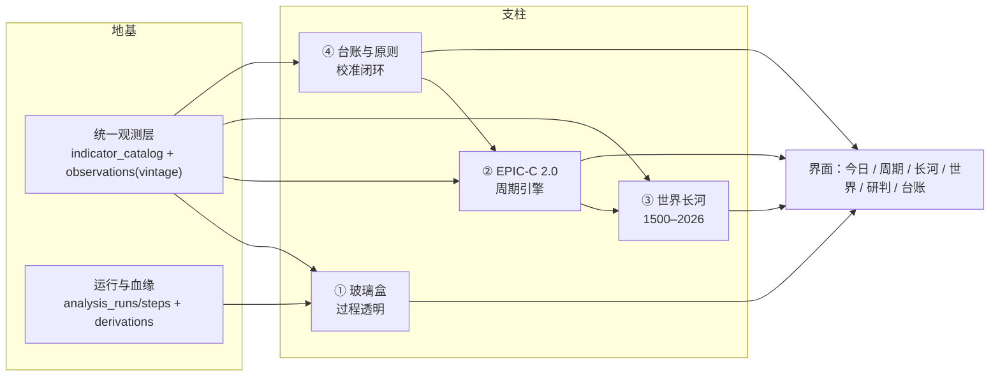
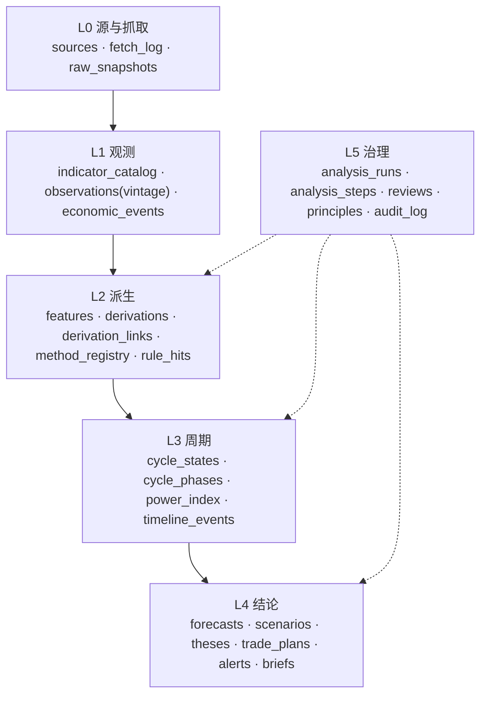

# 18 V2.0 改造总案（EPIC → 宏观周期研判台）

> 版本：V2.0 方案稿 ｜ 日期：2026-11-17 ｜ 基线：V1.3.0（`28bca2e`）
> 本文件是 V2.0 的顶层契约：定义定位、四大支柱、信息架构、数据模型演进、里程碑与取舍。其余文档是它的展开：
> [19 透明化业务流程](./19-透明化业务流程设计.md) ｜ [20 功能与接口](./20-功能与接口设计.md) ｜ [21 UI 设计](./21-UI设计规范.md) ｜ [22 EPIC-C 周期引擎 2.0](./22-EPIC-C周期引擎2.0.md) ｜ [23 历史周期图谱 1500–2026](./23-历史周期图谱1500-2026.md) ｜ [24 原则库与当下研判](./24-原则库与当下研判.md) ｜ 标杆研究：[TradingEconomics](./research/tradingeconomics-benchmark.md) ｜ [达利欧框架](./research/dalio-framework.md)

---

## 1. 定位：从「数据看板」到「可审计的宏观研判台」

### 1.1 V1.3 是什么

EPIC V1.3 已经是一个**能跑起来的个人宏观数据终端**（数字以 `docs/research/codebase-audit.md` 实测为准）：

- 25 个定时任务、40 张表、63 个 API 端点、8.4 万条日线、2.5 万条宏观观测、1.2 万条黄金指标；
- 9 个页面覆盖总览/行情/利率/分析/信号/黄金/论点/简报/系统；
- **211 条测试** + lint + CI + 14 项 DoD 检查，工程纪律良好；
- 新闻 → 断言 → 事件 → 告警 → 论点的知识链已经打通，带原文引用。

**它的强项是「采集与工程」，弱项是「研判与解释」**：

| 维度 | V1.3 状态 | 问题 |
|---|---|---|
| 数据广度 | 中美欧日 + 商品 + 贵金属，35 个标的 | 够用，但缺「跨国横向对比」与「指标目录」范式 |
| 数据深度 | 日线 + 部分月度，多数序列 2019 起 | 历史太短，无法做长周期判断 |
| 分析深度 | 5 因子 z-score → 4 象限；固定置信度 | 结论单薄、不可分解、不可复现 |
| 解释能力 | 简报由模板拼接，年报文字 | 用户看不到「为什么」 |
| 时间视野 | 当下 + 未来 3 个月 | 缺 5–100 年尺度 |
| 自我校验 | 预测 6 条、对账 0 条 | 没有反馈回路，无法知道自己准不准 |

审计逐行核对 `docs/03` 的 EPIC-C 设计后确认：**五层周期、政策三角、债务可持续性、传导图在代码中完全不存在或仅有空表**（`graph_edges` 0 行、`grep debt` 零命中）；四象限、情景树、类比库、证据链各有半成品，但概率写死（0.55/0.45）、置信度写死（0.4/0.35/0.45）。**V2.0 的主体工作量是把「设计文档里已经想清楚、代码里没长出来」的这五块补齐**，而不是另起一套框架。

### 1.1.1 已审计确认的 10 条技术债（V2.0 必须正面处理）

| # | 债务 | 证据 | 对应里程碑 |
|---|---|---|---|
| T1 | 分析结果**覆盖式写入**，只留最新快照 | `analytics/runner.py:35-44` 先 delete 再 insert | M0（改追加 + run_id） |
| T2 | 版本漂移：后端 1.3.0 vs 前端 1.1.0 | `frontend/package.json`、`lint.py:184-202` 漏检 | M0 |
| T3 | 无迁移框架，schema 靠手写轻迁移 | `platform/db.py:95-110` | M0 |
| T4 | 调度无 DAG/门禁，失败不阻断下游 | `jobs/runner.py:117-140`、壁钟排程 | M0（DAG 化） |
| T5 | 全部任务串行写锁，长任务挤占采集 | `scheduler.py:63-68` | M1 |
| T6 | 大量硬编码（指标元数据/新闻源/事件表） | `pipeline.py:112-135`、`analytics/events.py` | M1（元数据入库） |
| T7 | JSON 列无 schema、无外键 | `asset_ids/impacts/params/targets` | M1 |
| T8 | 前端无测试、单文件过大（Gold 1854 行） | 无 vitest/Playwright | M1–M5 持续 |
| T9 | 数据保留期口径冲突（14 天 vs 30 天） | `pipeline.py:358-361` vs `config.py` | M0 |
| T10 | LLM 链路未用真实 Key 跑通 | `scheduler.py:176-185` | M4（台账可选增强） |

> 原则：**先补溯源（T1/T3/T4），再上新模型。** 顺序反了就是给一个不可复现的系统加更多不可复现的结论。

### 1.2 V2.0 要成为什么

一句话：**一个能把自己的推理过程摊开给你看、并且每年都在变准的宏观周期研判台。**

三个不可妥协的属性：

1. **可审计（Auditable）**——任何数字可溯源到源、任何结论可分解到因子、任何历史可回放到当时的数据版本；
2. **有周期（Cyclical）**——不是看几个指标猜方向，而是把当下放进 5 层嵌套周期 + 500 年长周期的坐标系里；
3. **会学习（Calibrating）**——每个判断都登记、到期对账、按 Brier 分数校准，错的地方沉淀成原则与规则。

### 1.3 明确不做什么（Out of Scope）

| 不做 | 理由 |
|---|---|
| 实时交易执行 / 券商对接 | 个人研判工具，安全边界与合规成本都不值得 |
| 多用户 / 权限 / 订阅 | 本地单机，无多租户需求 |
| 196 国 × 2 万指标全量覆盖 | 维护不动，抓取失败与空值会淹没信息；收敛到「美/中/欧/日 + 商品 + 汇率 + 主要新兴市场」 |
| 复制 TE 的机翻文案与付费墙 | 无价值；且机翻术语错误（Collision→碰撞）会污染认知 |
| LLM 直接产出买卖建议 | 幻觉不可控；LLM 只用于抽取与叙述，结论必须由可复现规则给出 |
| 高频/日内策略 | 数据延迟与个人带宽都不支持 |

---

## 2. 对标 TradingEconomics：抄什么、不抄什么

### 2.1 值得借鉴的（已核实）

| # | TE 的做法 | 我方改造 |
|---|---|---|
| 1 | **指标卡固定 8 字段**：现值/前值/最高/最低/日期区间/单位/频率/季调 | 做成 `<MetricTile>` 组件，全站统一；字段映射到 `indicator_catalog` |
| 2 | **双向 IA**：国家→指标、指标→国家 | `/world` 下同时提供「国家档案」与「指标排行」两个入口，共用一套 `observations` |
| 3 | **日历五口径并列**：Actual/Consensus/Previous/Revised/TEForecast + 重要性 1–3 | 现有 `economic_events` 扩展 `revised/consensus/importance`，并加「预测 vs 实际」对账列（TE 没有，我方做差异化） |
| 4 | **把统计结论写成人话**：「从 3.40% 升到 3.70%，1914–2026 均值 3.29%，最高 23.70%(1920-06)」 | 模板化生成，作为每个数字下方的 `narrative` 行 |
| 5 | **指标详情页 = 叙事 + 日历（含未来发布日）+ 统计卡 + 同族 + 新闻** | 作为 `/world/indicator/:code` 的页面骨架 |
| 6 | **口径说明（如 CPI 篮子权重）写在卡片旁** | `indicator_catalog.definition_md` + 口径差异提示（同比/环比、季调/未季调） |
| 7 | **逐条 `Source` + `SourceURL`** | 已有 `sources` 表，升级为每个观测带 `source_id/fetch_id` |
| 8 | **稳定序列码 `series_key`** | 立即引入（现用 code 混用显示名，中文/英文/别名混乱） |
| 9 | **一套数据多视图 + 统一时间窗**（日/周/月/年/YTD） | 统一 `window` 参数枚举，表格/折线/热力/地图共用 |
| 10 | **数据免责与延迟标注** | 已有，强化为「asof + 延迟等级 + 降级徽标」 |

### 2.2 明确不抄的

| TE 的做法 | 为什么不抄 |
|---|---|
| 日历「下周/下月/昨天」加锁 | 本地工具锁自己；且锁住历史会毁掉回看 |
| importance 默认只勾 1★ | 首屏近乎无信息；我方默认 `importance ≥ 2` 且「本周」 |
| 只有点预测、无区间、无对账 | 恰恰是我们要超越的地方 |
| 自由文本单位 + 同比/环比各自成指标 | 单位枚举 + `transformation` 维度，避免指标膨胀 |
| 13 语言 × 196 国 | 收敛广度，投入深度（口径、历史、对账） |
| 无阈值告警（只推日历通知） | 我方已有阈值引擎，升级为「规则 + 置信度 + 反证」三类告警 |

> **差异化定位**：TE 卖「全世界的数字」，EPIC 卖「当下在历史中的位置 + 这个判断有多可靠」。前者是数据商，后者是研判台。

---

## 3. 四大支柱



### 支柱① 玻璃盒（Glass Box）

**目标**：任何数字 3 次点击内说清来历；任何结论能看到支持与反对的证据。

四个能力：结构透明（DAG）、过程透明（run/step）、推理透明（derivation/贡献分解）、不确定性透明（置信度/反证/失效条件）。

详见 [19 透明化业务流程设计](./19-透明化业务流程设计.md)。

### 支柱② EPIC-C 周期引擎 2.0

**目标**：把「猜方向」升级为「定位 + 概率 + 路径」。

- **五层嵌套**：长债务周期（75–100y）、短债务周期（5–8y）、库存周期（3–4y）、信用/流动性（1–2y）、政治周期（2/4y，含 2026-11 中期选举）；
- **大周期六阶段**（达利欧世界秩序框架）：新秩序建立 → 和平繁荣 → 债务泡沫 → 泡沫破裂 → 去杠杆 → 新秩序；
- **债务可持续性三模式**：通胀化债 / 通缩化债 / 财政主导，核心变量 `r − g`、利息/收入、币值；
- **状态向量 + 历史类比**：把当下 20 维特征与 1870–2026 的历史状态做最近邻，给出「现在最像哪一年」及后续 12 个月资产表现分布；
- **情景与资产映射**：4 象限 × 4 情景 × 8 类资产，输出概率加权后的资产倾向；
- **置信度与失效条件**：每个阶段判断带证据等级、校准记录、失效触发器。

详见 [22 EPIC-C 周期引擎 2.0](./22-EPIC-C周期引擎2.0.md)。

### 支柱③ 世界长河（1500–2026）

**目标**：把 500 年历史压成可交互的时间轴，为当下提供坐标。

- **五个世纪的主线**：价格革命与重商主义（1500–1700）→ 工业革命与金本位（1700–1914）→ 两次大战与布雷顿森林（1914–1971）→ 滞胀与金融化（1971–2008）→ 量化宽松与多极化（2008–2026）；
- **国家实力指数**：按 Maddison 式份额（人口/产出/贸易/军费/储备货币/科技），每年一个点，可播放；
- **周期叠加带**：把 5 层周期画在同一时间轴上，看「共振」与「错位」；
- **23 个可复用规律**（达利欧式）+ 每条的历史样本、命中率、失效条件。

详见 [23 历史周期图谱 1500–2026](./23-历史周期图谱1500-2026.md)。

### 支柱④ 台账与原则库

**目标**：让每个判断都被记账，让每次错误都变成规则。

- **预测台账**：登记（对象/期限/方向/概率/基准率/依据 run）、到期自动结算、Brier 分解（可靠性 + 分辨力）；
- **复盘归因**：数据错 / 模型错 / 执行错 / 运气；
- **原则库**：每条原则有出处（哪次错误）、指标、失效条件；可计算的进入规则影子测试，不可计算的进入人工检查清单；
- **规则版本治理**：`R-YYYY.MM`，升级前影子运行 ≥20 交易日，发布后生成「历史结论影响分析」。

详见 [24 原则库与当下研判](./24-原则库与当下研判.md)。

---

## 4. 信息架构：从 9 页到 8 区

### 4.1 现状 → 目标

| V1.3 页面 | V2.0 归属 | 处理 |
|---|---|---|
| `/` 总览 | **今日** | 重构为「晨报 + 关键异动 + 今日日历 + 预警」，一切可下钻 |
| `/market` 行情 | **世界 / 市场** | 并入世界区，加多视图（表/折线/热力）与统一时间窗 |
| `/rates` 利率 | **世界 / 利率** | 并入，补曲线与跨国利差 |
| `/analysis` 分析引擎 | **研判 / 引擎** | 升级为周期引擎工作台，加 DAG 与推导谱系 |
| `/signals` 信号 | **今日 / 预警** | 合并为「预警台」，含阈值/规则/反证 |
| `/gold` 黄金研判 | **专题 / 黄金** | 保留并接入 EPIC-C（黄金作为货币信用定价的锚） |
| `/theses` 论点 | **研判 / 论点** | 保留，绑定 derivation |
| `/briefs` 简报 | **今日 / 简报** | 保留，加「数据时点 + 审计包导出」 |
| `/system` 系统 | **系统** | 扩展：数据源健康、运行历史、版本、审计日志 |
| `/legacy` 旧版 | 已删除 | 过渡期看板与路由已于 V1.3 收尾时删除（2026-11-17） |

### 4.2 新导航（8 区）

```
今日 Today        ← 晨报 / 异动 / 日历 / 预警
周期 Cycles       ← 周期罗盘 / 五层嵌套 / 国家矩阵 / 历史类比
长河 Long River   ← 1500–2026 时间轴 / 实力对比 / 周期叠加 / 规律库
世界 World        ← 国家档案 / 指标目录 / 跨国对比 / 行情 / 利率
研判 Analysis     ← 引擎工作台 / 管线 DAG / 推导谱系 / 反事实沙盘 / 论点
台账 Ledger       ← 预测台账 / 校准曲线 / 复盘 / 原则库
专题 Gold         ← 黄金 22 指标 + 货币信用定价
系统 System       ← 数据源 / 任务 / 版本 / 审计
```

**设计原则**：
1. 每个区都有「一屏结论 + 下钻到底层数据」两级结构；
2. 全局顶栏常驻「数据时点 + 运行 ID + 降级状态」，任何页面都知道自己看到的是什么时候的数据；
3. 跨区引用用统一的 `DerivationRef` 组件，点击统一打开「为什么」抽屉。

---

## 5. 数据模型演进（40 表 → 约 60 表）

### 5.1 分层



### 5.2 关键变更

| 变更 | 内容 | 兼容策略 |
|---|---|---|
| **新增 `observations`** | 统一观测量（含 `revision`/`vintage_date`），取代 `macro_obs`/`gold_metrics` 的散装存储 | 双写过渡；旧表保留只读 |
| **新增 `indicator_catalog`** | 指标元数据：`series_key`、单位枚举、频率、`transformation`、口径说明、许可 | 由现有 22 条 `macro_series` 迁移生成 |
| **新增 12 张透明化表** | `analysis_runs`/`steps`/`derivations`/`derivation_links`/`method_registry`/`rule_hits`/… | 全新，无迁移 |
| **`predictions` → `forecasts`** | 补齐概率、基准率、失效条件、Brier 分解 | 6 条预测迁移 |
| **`analytics_results` 降级** | 仅作缓存，真相在 `derivations` | 保留，新增 `derivation_id` 列 |
| **新增 4 张历史表** | `timeline_events`、`power_index`、`cycle_history`、`principles` | 全新，静态导入 |
| **`instruments` 扩展** | 加 `asset_class`/`region`/`currency`/`is_proxy` | 加列，默认值兜底 |

### 5.3 数据量与性能预算

| 项 | 估算 | 处理 |
|---|---|---|
| `observations` 年增 | 约 30 万行/年 | SQLite 无压力；按 `series_id` 建索引 |
| `analysis_steps` 年增 | 25 任务 × 365 × 平均 8 步 ≈ 7 万行/年 | 保留 180 天明细，之后聚合归档 |
| `derivations` 年增 | 约 5 万条/年 | JSON 压缩存储，索引 `asof` + `method_id` |
| `timeline_events` | 约 3,000 条 | 静态 |
| 页面首屏 | < 800ms（本地） | 预计算 + 缓存；ECharts 按需加载 |

---

## 6. 里程碑与工作量

| 里程碑 | 内容 | 产出 | 预估 | 依赖 |
|---|---|---|---|---|
| **M0 地基** | `observations`、`indicator_catalog`、`analysis_runs/steps`、`derivations` schema；采集/解析/标准化三段留痕 | 迁移脚本、双写开关、数据字典 | 3 周 | 无 |
| **M1 玻璃盒** | `/pipeline` DAG、运行详情、数字来源卡、「为什么」抽屉、只读回放 | 6 个新 API、3 个新页面 | 3 周 | M0 |
| **M2 周期引擎 2.0** | 长债务/短债务/库存/信用/政治五层；债务可持续性；状态向量；历史类比；情景映射 | `cycle` 模块、`/api/cycle/*`、周期罗盘页 | 4 周 | M0 |
| **M3 世界长河** | 1500–2026 事件库、实力指数、周期叠加、规律库 | 静态数据包、长河页、规律卡 | 3 周 | M2 |
| **M4 台账闭环** | 预测登记/结算/Brier、复盘归因、原则库、规则版本治理 | `forecasts` 页、校准曲线、原则库页 | 2 周 | M2 |
| **M5 打磨** | UI 统一（token/tile/抽屉）、性能、导出审计包、文档 | 设计系统、审计包、README 索引 | 2 周 | M1–M4 |

**总计约 17 周**（可并行压缩到 12 周）。单人开发建议顺序：M0 → M1 → M2 →（M3 与 M4 并行）→ M5。

### 6.0 实施记录（2026-11-17 完成）

| 里程碑 | 状态 | 实际落地 | 提交 |
|---|---|---|---|
| M0 地基 | ✅ | `backend/app/models/v2.py`（13 表）、`backend/app/provenance/`（RunRecorder / derive_id / methods）、`/api/v2/*` 7 个玻璃盒端点、`analytics/runner.py` 与 `gold/runner.py` 接入血缘 | `161a266` |
| M1 玻璃盒 | ✅ | `/pipeline` 透明管线页、`DerivationDrawer` 五层抽屉、分析页周期/风向溯源入口、`api/v2` 前端客户端 | `7ebdc34` |
| M2 周期引擎 2.0 | ✅ | `config/cycle.yaml`、`backend/app/cycle/`（config/market/indicators/composite/phases/history/sustainability/world/analogs/scenarios/alerts/engine 12 模块）、`/api/v2/cycle/*`、`/cycle` 周期罗盘、`/alerts` 预警台 | `e5bd1bb` + `d33fae1` |
| M3 世界长河 | ✅ | `backend/app/timeline/`（73 事件 / 6 霸权 / 27+8 份份额 / 6 维 / 3 类比 / H1–H10）、`/api/v2/timeline/*`、`/history` 页 | `649185f` |
| M4 台账闭环 | ✅ | `backend/app/ledger/`（26 条原则、四态核对、预测登记与 Brier 校准）、`/api/v2/ledger/*`、`/ledger`、`/principles` | `38eb7dd` + `fdb1d83` |
| M5 打磨 | ✅ | 总览页「长债务 → 短周期 → 预警」定位条、调度器新增 cycle/ledger/timeline 三个作业（16:20 / 16:45 / 周日 09:30）、版本 2.0.0、README 与文档索引更新、全量回归 266 tests + lint PASSED | 见 CHANGELOG |
| UI 对齐 | ✅ | 壳层四组导航（今日/市场/研判/系统）与数据时点/健康度、`/cycle` `/alerts` `/pipeline` `/history` 按合并原型重做、市场 CSV 导出与 E0 证据列、简报关联证据卡、总览近期事件与真实 KPI 进度条；后端新增 8 项接口（coverage / cycle meta / config PATCH / scenario / readings / 财经日历扩展 / eras 扩展 / briefs 证据） | 见 CHANGELOG |
| 可用性九项 + 交易模块 | ✅ | 下线「设计规范」页、`/cycle` 白屏修复（后端 `_normalize_state()` + 前端防守）、研判二级菜单四组归类、事件/新闻/告警中英对照（`POST /api/knowledge/translate`）、判研六页内容补全、全站时间口径统一（数据生成时间移入标题旁 `.gen-at`）；「交易日志」升级为独立交易台账（`/api/trades` 七端点 + `/trades` 页面，股票/期货等品种 + 计划到复盘的纪律字段）；世界长河按原型 1:1 重绘（`HistoryTimelineChart.vue`，储备带 + 四泳道 + 事件形状，画布自适应）；顶栏拆成「绿点+采集时间+健康%」与「系统当前时间 `yyyy-MM-dd HH:mm:ss`」两个 pill | 见 CHANGELOG |
| 全系统审计补齐 | ✅ | 结构性宏观从 YAML 常数改为真实序列：新增 `collect_macro` 作业 + 4 个 provider（美国财政部 Fiscal Data / 世界银行 / IMF DataMapper / `ProviderError`），`macro_series` 22→34 条，`cycle/structural.py` 让 7 条结构性读数 3 条走实时（E2）、4 条显式回落并注明原因；流水线看门狗 `reconcile_stale_analysis_runs()` + 启动补跑 `jobs/catchup.py`（实测补跑 premarket 简报）；台账 `auto_register_forecasts()` 每轮登记 9 指标 × 30/90 天预测（实测 18 条 open）并修 `_latest_market_value()` 列名错误；数据质检年频窗口 400→800 天（`coverage.py`/`pipeline.py`/`continuity.py`），重跑 10 项 0 失败；前端补「引擎透明度」「预测台账未结/已结」「任务时效列」「结构性读数表」与空态提示，删除未引用的 `TokensView.vue`；侧栏去徽标并收窄至 196px；341 tests + lint PASSED | 见 CHANGELOG |

实际投入：单日完成（设计文档在前，实施按 M0→M5 顺序推进）。与计划的偏差：① 未引入 Alembic，新增表沿用 `create_all` + 轻量迁移，原因是单机 SQLite 与既有约定；② `/api/v2` 为新增路径，旧 `/api/*` 全部保留，未做破坏性替换；③ Google Fonts 未引入（遵守无外链约束），图表字体沿用系统栈。

### 6.1 每个里程碑的验收（DoD）

| 里程碑 | 验收标准 |
|---|---|
| M0 | `pytest` 全绿；新表有迁移与回滚；30 个页面数值 100% 可溯源；旧表数据零丢失 |
| M1 | DAG 可见 25 任务状态；任一结论可展开 5 层抽屉；重放 3 次结果一致；时点回放无前视 |
| M2 | 五层周期各有一张图与一份文字判断；每层带置信度与失效条件；历史类比 Top-5 附后续表现 |
| M3 | 时间轴可播放 1500–2026；实力指数有 6 国 × 500 年；10 条历史规律各带样本与命中率 |
| M4 | 预测 100% 自动结算；校准曲线可见；每条原则有出处；规则升级有影响分析 |
| M5 | 全站 token 统一；Lighthouse 性能 ≥ 85；导出含 `audit_bundle.zip` |

---

## 7. 技术选型与架构约束

| 项 | 决定 | 理由 |
|---|---|---|
| 后端 | 保持 FastAPI + SQLAlchemy + APScheduler + SQLite | V1.3 已验证；单人维护成本最低 |
| 前端 | 保持 Vue 3 + TS + Vite + ECharts | 已有 9 页资产；ECharts 足够画周期带/桑基/热力 |
| 状态 | Pinia + 新增 `useAsOf()` 全局时点 | 统一「当前看到的数据时点」 |
| 样式 | Tailwind + CSS 变量 token | 与现有原型一致；深浅色切换 |
| 数据文件 | 历史静态数据用 JSON/CSV 打包进 `data/reference/` | 不依赖网络，可版本化 |
| LLM | 仅用于抽取与叙述，且必须 `E4` 标注 | 防幻觉；结论由规则给 |
| 测试 | 每个新模型必须有「金标准样本」测试 | 周期引擎尤其需要固定输入的期望输出 |
| 迁移 | Alembic 或自写 `scripts/migrate_*.py` | 40 表已有数据，必须可回滚 |

### 7.1 兼容与渐进

- **API 不破坏**：现有 63 个 API 操作（59 条路径、56 个路由装饰器）保持；新增端点走 `/api/v2/*` 或语义化新路径（`/api/cycle/*`）；
- **页面不破坏**：旧页面在新页面就绪后逐个跳转（过渡期 `/legacy` 兜底已随 V1.3 收尾删除，git 历史可找回）；
- **双写期**：`observations` 与旧表双写 ≥2 周，比对一致后切读；
- **工作区纪律**：当前有 79 个未提交修改，V2.0 开发必须在独立分支/worktree 进行，不覆盖这些改动。

---

## 8. 风险与对策

| # | 风险 | 影响 | 对策 |
|---|---|---|---|
| R1 | 历史数据太短（多序列 2019 起），长周期判断不可靠 | 结论失真 | 引入公开长期序列（Shiller、Maddison、BIS、FRED 长序列）做参照；置信度按覆盖率下调 |
| R2 | 达利欧框架主观性强，难以证伪 | 变成「讲故事」 | 每条规律必须给出可计算代理变量 + 历史命中率；不可计算的降为 E4 |
| R3 | 透明化带来巨大开发量，拖慢核心功能 | 交付延期 | 透明化与功能同批做（schema 先行），不做「事后补」；M0 一次性打好地基 |
| R4 | 1500 年史实细节易错 | 可信度受损 | 只用权威二手来源（Maddison、Reinhart-Rogoff、Bairoch），标注不确定；不确定处标「争议」 |
| R5 | SQLite 并发与写入锁 | 任务冲突 | 已有 `writelock`；新表沿用；分析结果预计算 |
| R6 | 过度设计导致个人工具不可维护 | 半途而废 | 每个里程碑独立可交付；宁少勿多，先做「能用的 60%」 |
| R7 | 数据源失效/限流 | 研判中断 | 降级链 + 显式降级徽标（见 19 §5.5）；关键序列至少 2 个源 |
| R8 | 判断被自己的偏好污染（确认偏误） | 决策质量下降 | 强制记录反对证据与失效条件；预测台账公开对自己打脸 |

---

## 9. 成功标准

V2.0 完成后，应能通过以下「一分钟测试」：

1. 打开「今日」，30 秒内知道：当下处于什么周期、最重要的一件事是什么、为什么；
2. 点任何数字，看到它的源、抓取时间、公式、修订史；
3. 点任何结论，看到贡献分解、命中的规则、反对证据、什么会推翻它；
4. 打开「长河」，看到 1500 年至今的周期带与自己所在的位置，并知道「历史上最像现在的是哪几年」；
5. 打开「台账」，看到自己过去 12 个月的预测准确率，以及比基准率强多少；
6. 导出任何简报，得到一个可独立验证的审计包。

如果这 6 条有任一做不到，V2.0 就不算完成。

---

## 10. 与既有文档的关系

| 文档 | 关系 |
|---|---|
| `docs/03-分析框架与模型设计.md` | EPIC-C 的思想来源；编号 22 是它的工程化重写 |
| `docs/15-前端改造方案.md` | 15 的 UI 主张被 21 吸收并升级为设计系统 |
| `docs/17-黄金监控与综合研判.md` | 黄金专题保留，接入 EPIC-C 的「货币信用」维度 |
| `docs/19-透明化业务流程设计.md` | 本文支柱①的实现规格（表、API、流程、验收） |
| `docs/20-功能与接口设计.md` | 本文支柱①②③④的功能清单与接口契约 |
| `docs/21-UI设计规范.md` | 本文 IA 的界面规范与组件库 |
| `docs/22-EPIC-C周期引擎2.0.md` | 本文支柱②的模型、指标、公式与校验 |
| `docs/23-历史周期图谱1500-2026.md` | 本文支柱③的史实与时间轴数据源 |
| `docs/24-原则库与当下研判.md` | 本文支柱④的原则清单与 2026-11 当下定位 |
| `docs/design/mockup/` | V1.5 静态原型；`mockup-v2/` 是 V2.0 交互原型 |
| `docs/research/tradingeconomics-benchmark.md` | 第 2 章的实测依据（IA/卡片/API/付费墙） |
| `docs/research/dalio-framework.md` | 支柱②③④的原文出处、标记体系与未核实清单 |
| `docs/research/codebase-audit.md` | 1.1/1.1.1 的实测依据（端点、表、算法、技术债） |

### 文档阅读顺序

**决策者**：18 → 21（看界面像什么）→ 24（看结论是什么）
**开发者**：18 → 19 → 20 → 22
**研究者**：24 → 23 → research/ 三份笔记
