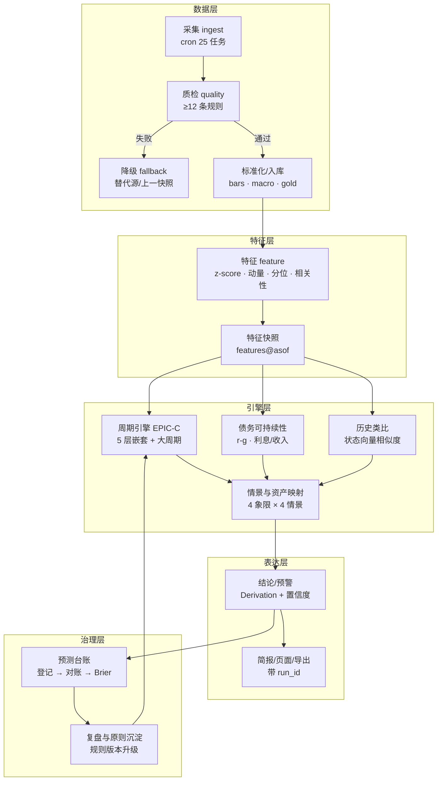
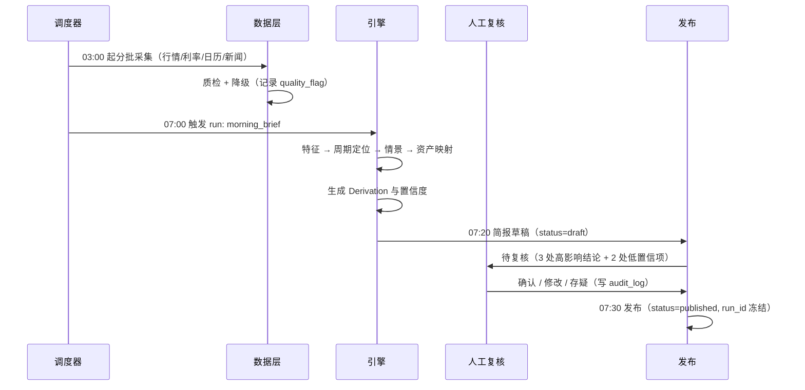
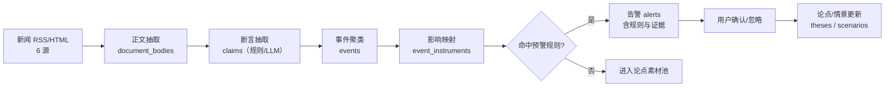
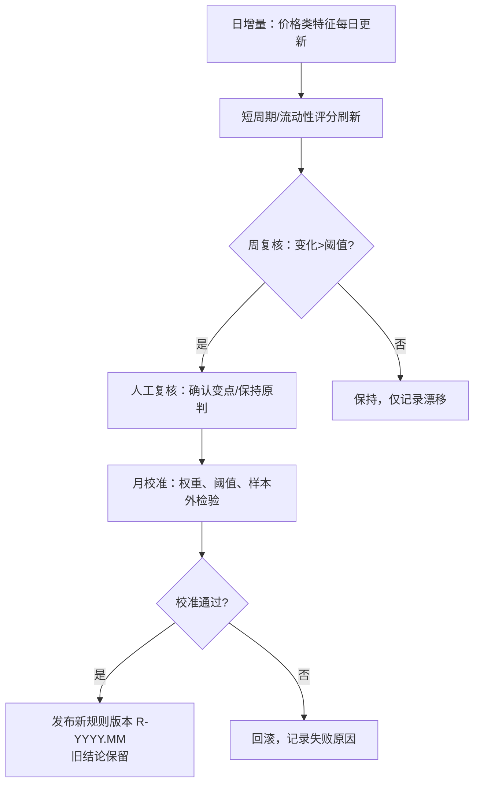
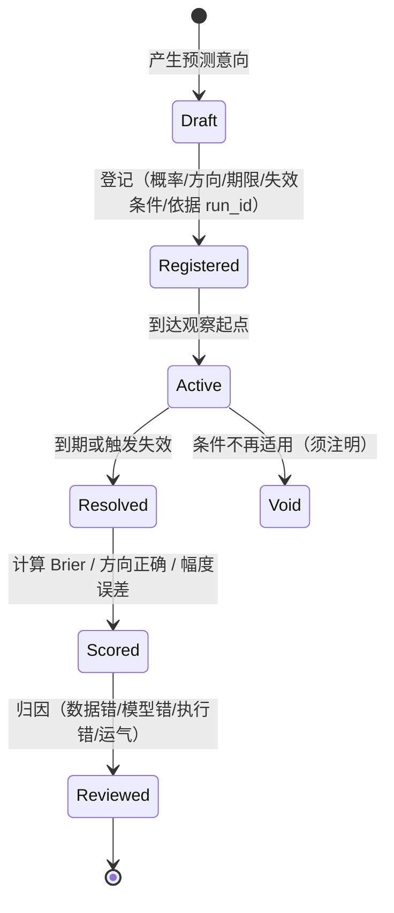
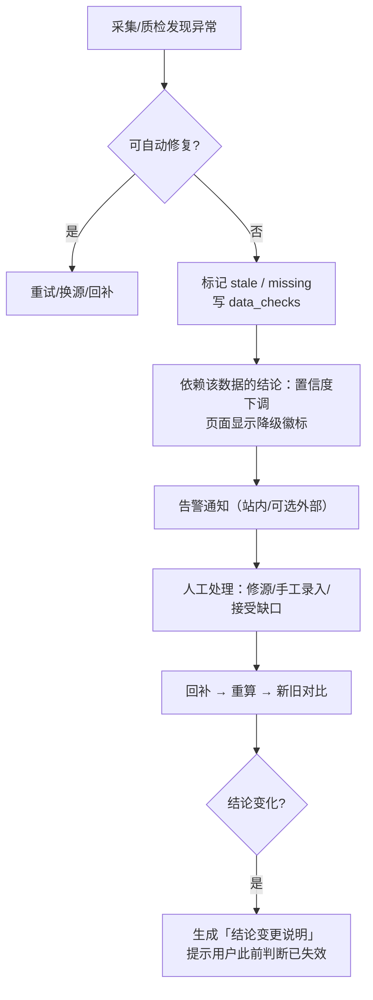
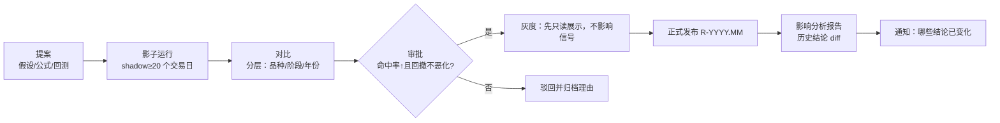

# 19 透明化业务流程设计（Glass Box）

> **本文要解决的问题**：使用者看到任何一个数字或结论时，都能在 3 次点击内回答——「它是哪来的、怎么算的、有多可信、什么情况下会错」。
>
> 关联：[18 改造总案](./18-V2.0改造总案.md) ｜ [20 功能与接口](./20-功能与接口设计.md) ｜ [21 UI 设计](./21-UI设计规范.md) ｜ [22 周期引擎](./22-EPIC-C周期引擎2.0.md)

---

## 1. 为什么把「透明化」列为第一性需求

V1.3 已经做到「结论可溯源到新闻原文」，但**数值与研判的生产过程仍然是不透明的**：

| 现状 | 用户的实际困惑 |
|---|---|
| `analytics/regime.py` 输出「过热/滞胀」，只给一个 `confidence: 0.4` 常数 | 40% 是怎么来的？换个窗口会不会变成复苏？ |
| `gold/scoring.py` 给 22 项指标加权，权重写死在代码 | 为什么这一项占 8%？把它调成 12% 结论会变吗？ |
| `analysis_results` 只存 `payload + code_version` | 三个月后回看，已经无法复现当时的输入与参数 |
| 简报由模板拼接，结论与证据之间靠 `claim_id` 关联 | 一条结论引用了 3 条证据，但它们各占多少权重？反对证据在哪？ |
| 任务失败后自动降级，页面上只显示「延迟」 | 降级时用了什么替代口径？结论可信度因此下降了多少？ |

因此 V2.0 把透明化定义为**产品的一等功能**，不是附加的「关于」页面。目标可以量化为一句话：

> **任何一个展示出来的数字，都能追溯到一条可重放的生成链；任何一条结论，都能看到支持它的和反对它的证据，以及它被什么事实推翻。**

---

## 2. 透明化的四层模型与证据分级

### 2.1 四层透明

| 层 | 回答的问题 | 载体 | 用户入口 |
|---|---|---|---|
| **L1 结构透明** | 系统由哪些环节组成？数据从哪来到哪去？ | 架构图、流水线 DAG、数据字典、模型卡 | `/pipeline`、`/system` |
| **L2 过程透明** | 这个数字是哪一次运行、哪一步、用什么参数算出来的？ | Run / Step / Trace 记录、原始快照、日志 | 每次运行详情、节点抽屉 |
| **L3 推理透明** | 结论为什么是这个？各因素贡献多少？命中了哪些规则？ | Derivation（推导谱系）、贡献分解、规则命中、反事实 | 结论卡「为什么」抽屉 |
| **L4 不确定性与反证** | 有多可信？哪里可能是错的？什么事件会推翻它？ | 置信度、覆盖率、校准曲线、反对证据、失效触发器 | 置信度徽标、反证区 |

四层缺一不可：只有 L1/L2 会变成「工程师看得很爽、用户仍然不懂」；只有 L3/L4 则无法复现、无法审计。

### 2.2 证据等级 E0–E4

所有在界面上出现的数字/结论都带一个等级徽标，等级决定它能否被用作交易依据：

| 等级 | 定义 | 例子 | 允许的用法 |
|---|---|---|---|
| **E0 原始观测** | 授权数据源的原始值，未经变换 | 美债 10Y = 5.12%；LME 铜 = 13,210 | 可直接引用，须显示源与抓取时间 |
| **E1 派生指标** | 单源、确定性变换 | 10Y−2Y 利差、同比、z-score、60 日动量 | 可引用，须显示公式与窗口 |
| **E2 交叉验证** | ≥2 个独立源/替代口径一致，或通过数据质检 | 用财政部 CSV 与行情源交叉验证利率；金价与伦敦金现互校 | 可作为主要依据 |
| **E3 模型结论** | 规则/统计模型输出，附校准记录 | 周期象限、黄金评分、情景概率 | 必须带置信度 + 历史校准 + 失效条件 |
| **E4 叙事判断** | LLM 或人工撰写的解释性文字 | 简报中的因果叙述、历史类比的故事线 | 只能作为假设来源，必须被 E0–E3 支撑 |

> 规则：**E4 不得单独构成交易信号**；任何交易计划至少需要 1 条 E2 + 1 条 E3。

---

## 3. 数据是怎么生成出来的：血缘模型

### 3.1 七段式血缘

任何一个入库数值都走过同一条链，每一段都留痕：


对应现有代码与 V2 改造点：

| 段 | 现有实现 | V2 补齐 |
|---|---|---|
| 源 | `sources` 表、`config/default.yaml` | 增加许可字段、抓取条款、优先级、降级链 |
| 抓取 | `ingest/http.py`（限速/重试/快照）、`source_health` | 每次抓取写 `fetch_log`（请求 URL、状态、字节数、耗时） |
| 原始快照 | `data/raw/` + `raw_path` | 快照索引与 sha256 校验、保留策略 |
| 解析 | `ingest/providers/*.py`、`tests/test_parsers.py` | `parser_id@version` 落库，解析失败样本留存 |
| 标准化 | `ingest/pipeline.py`、`platform/instrument_units.py` | 单位换算表版本化（如「元/吨 → 美元/吨」汇率口径） |
| 校验 | `ingest/bars_quality.py`、`data_checks` | 质检规则可配置、失败自动降级并标注 |
| 观测 | `market_bars` / `macro_obs` / `gold_metrics` | **新增 vintage（修订版本）**，支持 point-in-time 回测 |
| 派生 | `analytics/*`、`gold/scoring.py` | 每个派生值写入 `derivations`，含公式与输入哈希 |

### 3.2 关键设计：Vintage（时点快照）

宏观数据会被修订。若回测时用了「今天才知道的修订值」，就是前视偏差（look-ahead bias）。V2 规定：

```sql
-- 观测表增加 vintage 维度
observations(
  series_id, ts, value, revision,          -- 修订号 0,1,2...
  first_seen_at,                            -- 本系统第一次看到该值的时间
  vintage_date,                             -- 该值在当时「官方当时值」
  source_id, fetch_id
  PRIMARY KEY (series_id, ts, revision)
)
```

界面与回测默认使用 `as_of(vintage_date <= 当时日期)` 的最新版本；「当前视图」用最新 vintage。任一数字都可以切换「当时看到的 / 现在修订后的」两种口径——这是很多商业终端都没有的能力，也是「数据如何生成」最硬核的透明。

### 3.3 派生值的可复现哈希

```
derivation_id = sha256(
    method_id + "@" + method_version
  + "|" + sorted(input_ids_with_revision)
  + "|" + canonical_json(params)
  + "|" + code_sha
)
```

- 相同输入 + 相同参数 + 相同代码 → 相同 `derivation_id`，结果必须逐位一致；
- 任一变化 → 新 id，旧结论仍可回放；
- 界面上的每个数值都挂 `derivation_id`，点击即展开谱系。

---

## 4. 研判是怎么生成出来的：推理谱系

### 4.1 Derivation Schema（结论级）

每一个结论（页面上的卡片、预警、简报段落、交易计划）都对应一个 `Derivation` 对象：

```json
{
  "derivation_id": "d_9f3c…",
  "claim": "美国处于长债务周期晚期（债务货币化）",
  "value": "late_monetization",
  "confidence": 0.73,
  "evidence_grade": "E3",
  "asof": "2026-11-17",
  "horizon": "12-36m",
  "method": {"id": "EPIC-C/BIG-CYCLE", "version": "2.0.0", "doc": "/docs/22"},
  "inputs": [
    {"ref": "US10Y_REAL", "asof": "2026-11-16", "value": 2.92, "transform": "level", "weight": 0.18},
    {"ref": "US_DEBT_GDP", "asof": "2026-Q3", "value": 123.4, "transform": "level", "weight": 0.22}
  ],
  "steps": [
    {"seq": 1, "name": "feature.zscore", "params": {"window": 250}, "output": 2.1, "ms": 3},
    {"seq": 2, "name": "big_cycle.stage_score", "params": {"weights_version": "R-2026.11"}, "output": 0.73, "ms": 1}
  ],
  "rules_hit": [
    {"rule_id": "R-BC-07", "condition": "real_rate>2 and gold_60d_corr<0", "hit": true, "weight": 0.2,
     "text": "实际利率与金价相关性转负 → 货币信用定价"}
  ],
  "counterfactual": [
    {"change": "实际利率 -100bp", "delta_confidence": +0.08},
    {"change": "央行购金 -40%", "delta_confidence": -0.11}
  ],
  "caveats": ["债务/GDP 为季度值，滞后 1 个季度", "中国数据口径与 BIS 存在差异"],
  "falsifiers": ["US30Y 连续 3 个月回落至 4.5% 以下且金价同步下跌"],
  "supporting_evidence": ["claim:3921", "doc:288"],
  "opposing_evidence": ["claim:3987"],
  "lineage_hash": "sha256:…"
}
```

### 4.2 贡献分解（Contribution Decomposition）

「置信度 73%」必须能拆开。采用**可加分解**：对线性加权模型直接给出 `w_i × z_i` 的贡献；对非线性模型用 Shapley 近似（按 8–12 个输入枚举子集成本可接受），并显示残差项。界面用瀑布图呈现：

```
长债务周期阶段分 73
├─ 债务/收入水平            +18.2
├─ 实际利率与 r−g           +15.6
├─ 央行资产负债表扩张         +12.4
├─ 储备货币份额下降           +11.8
├─ 黄金/货币贬值信号          +9.1
├─ 内部冲突指数              +7.3
├─ 外部冲突指数              +4.9
└─ 残差/交互项               −5.3
```

> 规则：残差绝对值 > 20 分时，页面必须提示「模型解释力不足，结论仅供参考」，并把置信度上限压到 0.6。

### 4.3 规则命中可读化

每条规则在 `method_registry` 中登记为：

```
rule_id: R-BC-07
if: US10Y_REAL > 2.0 and corr(GOLD, US10Y_REAL, 60d) < -0.2
then: phase_weight("late_monetization") += 0.20
why: 达利欧：当实际利率高企而金价仍涨，说明市场在为货币信用/财政风险定价，而非交易利率
source: 《债务危机》ch.2 通胀型去杠杆；《原则：应对世界秩序变化》ch.5
```

界面展示人话版本 + 命中条件 + 证据链接 + 命中历史（过去 10 年触发 4 次，之后 6 个月金价中位数 +8.2%，胜率 3/4）。

### 4.4 反事实（Counterfactual）与敏感性

每个 E3 结论必须提供 3 个敏感性测试（自动）：

| 类型 | 做法 | 展示 |
|---|---|---|
| 参数敏感 | 权重 ±20%、窗口 ±50% | 结论是否翻转；翻转阈值 |
| 输入敏感 | 单输入 ±1σ / ±10% | 置信度变化 ±Δ |
| 数据敏感 | 换替代源（如用 Shibor 替 SOFR） | 结论一致性 |

原型中的「反事实沙盘」即此功能的交互形态：拖动实际利率/美元/购金三个滑块，结论强度实时变化，并提示「在什么取值下结论翻转为 X」。

---

## 5. 业务流程设计（8 条主流程）

### 5.0 全链路总图



### 5.1 F1 晨间研判流（每日 07:00–08:30）

**目标**：开盘前给出一份「今天该关注什么、为什么、错了会怎样」的简报，全部可溯源。



| 步骤 | 输入 | 输出 | 透明化挂点 | SLA | 失败处理 |
|---|---|---|---|---|---|
| 采集完成度检查 | 25 个 job 最近状态 | `data_ready_score` | 每个数据集的 `asof`、失败任务 | 06:50 | <80% 时简报标注「数据不完整」并压置信度 |
| 特征计算 | 14+ 序列 | `feature_snapshot` | 窗口、单位、缺失率 | 20s | 缺失 → 用上一可用值 + 标注 staleness |
| 周期定位 | 特征 + 规则权重 | 象限/阶段 + 概率 | 规则命中、贡献分解 | 5s | 规则冲突 → 输出「过渡态」并降低置信度 |
| 情景生成 | 周期 + 事件 + 日历 | 3–5 个情景及概率 | 情景触发条件、资产映射 | 5s | 概率和 ≠ 100% → 归一化并提示 |
| 简报生成 | 以上 + 新闻 | Markdown | 每段引用 `derivation_id` | 3s | 生成失败 → 退回模板并标注 |
| 人工复核 | 草稿 | 确认/修改 | 修改 diff、复核人、时间 | 10min | 未复核 → 自动发布但标「未复核」 |

**产物**：`briefs` 行（带 `run_id`、`data_ready_score`、`review_status`）、页面 `/` 与 `/briefs`。
**不变量**：已发布的简报不可改，只能发新版（`briefs.version`）。

### 5.2 F2 事件驱动流（全天，每 3–30 分钟）



| 透明化要求 | 实现 |
|---|---|
| 为什么这条新闻重要 | 显示命中的规则、涉及标的、历史同类事件后的资产反应（中位数、样本数） |
| 断言是否可信 | 断言级 confidence（来源分级 × 抽取方式 × 是否多源一致） |
| 告警为何触发 | 告警详情内嵌「触发链」：新闻 → 断言 → 事件 → 规则 → 阈值 |
| 误报如何沉淀 | 用户点「误报」→ 写 `alert_feedback`，进入规则调优队列 |

### 5.3 F3 周期定位更新流（日增量 / 周复核 / 月校准）



**关键规则**：
- 阶段切换必须经过**滞回（hysteresis）**：进入某阶段阈值 0.65，退出阈值 0.45，避免在边界反复横跳；
- 变点检测用 CUSUM + 规则双通道，两者不一致时输出「过渡态」；
- 每次规则版本升级，自动生成「影响分析」：过去 5 年有多少天结论会变、哪些资产映射会变（见 5.6）。

### 5.4 F4 预测登记 → 对账 → 校准流



| 字段 | 说明 |
|---|---|
| `subject` / `horizon` / `direction` / `probability` | 预测对象、期限、方向、概率 |
| `base_rate` | 同类历史基准概率（用于判断是否有真实「边际信息」） |
| `derivation_id` | 产生该预测的完整谱系 |
| `falsifier` | 提前终止/判定错误的条件 |
| `outcome` / `brier` / `log_loss` | 对账结果 |
| `attribution` | 复盘归因标签 |

**透明化要求**：预测台账页面必须同时展示「我的预测」与「基准率」，让用户看到自己是否真的比抛硬币强；Brier 分解为可靠性（calibration）+ 分辨力（resolution）。

### 5.5 F5 数据异常与降级流



**设计要点**：降级不是隐藏，而是**显式降级**——页面上出现 `⚠ 降级` 徽标，点开显示「原口径 / 替代口径 / 影响哪些结论 / 置信度下降多少」。

### 5.6 F6 模型与规则变更流（发布治理）



### 5.7 F7 复盘与原则沉淀流（周/月）

```
一周交易与预测 → 结果对账 → 归因四分类（数据/模型/执行/运气）
→ 提炼为「原则」条目（可观测、可执行、可证伪）
→ 若可计算：登记为规则 → 进入影子测试
→ 若不可计算：进入检查清单（人工复核项）
→ 更新原则库版本，记录「这条原则来自哪次亏损」
```

> 达利欧「痛苦 + 反思 = 进步」的工程化：**每条原则必须有出处（哪次错误）、有指标、有失效条件**，否则不允许进入规则库。

### 5.8 F8 导出与审计包（按需）

导出任何报告时，附带一个 `audit_bundle.zip`：

```
audit_bundle/
├── manifest.json          # run_id / git_sha / 规则版本 / 数据 asof
├── inputs/                # 本次用到的观测（CSV，含 vintage）
├── derivations/           # 每条结论的 derivation JSON
├── evidence/              # 证据快照（文档哈希 + 摘录）
└── methodology.md         # 模型卡与已知限制
```

用途：三个月后复查、与他人讨论时自证、避免「事后诸葛」。

---

## 6. 透明化在界面上的六个入口

| # | 入口 | 位置 | 交互 | 对应层 |
|---|---|---|---|---|
| 1 | **「为什么」抽屉** | 每个结论卡右上角 | 5 层折叠：结论 → 贡献 → 规则 → 特征 → 原始数据 | L3/L4 |
| 2 | **数字血缘** | 任何数值（含表格单元格） | 点击弹出「来源卡」：源、抓取时间、修订号、单位、计算公式 | L2 |
| 3 | **流水线 DAG** | `/pipeline` | 节点状态 + 点击看步骤详情、日志、耗时、影响的下游 | L1/L2 |
| 4 | **本次运行** | 顶栏「数据时点」旁 | 显示 `RUN-…`、耗时、成功率、覆盖率；点击进运行详情 | L2 |
| 5 | **反证与失效** | 结论卡底部「什么会推翻它」 | 列出反对证据 + 失效触发器 + 下次检查时间 | L4 |
| 6 | **版本与影响** | `/system/versions` | 规则/权重/数据源版本 diff，及「历史上多少结论会变」 | 治理 |

**交互规范（强制）**：

- 可下钻的数字必须有下划线或 `cursor: pointer`，且 `aria-label` 说明「查看来源」；
- 抽屉打开时锁定背景滚动，`Esc` 关闭，焦点回到触发元素；
- 所有置信度必须同时显示数值与文字措辞（见 §8）；
- 任何「降级/缺失/滞后」必须有可见徽标，禁止静默；
- 打印/导出时，证据脚注自动附在文末，且保留 `run_id`。

---

## 7. 可复现与回放（Replay）

### 7.1 运行记录

```
analysis_runs(id, kind, asof, engine_version, git_sha, config_hash,
              status, started_at, finished_at, cost_ms,
              inputs_hash, outputs_hash, notes)
analysis_steps(id, run_id, seq, name, module, status,
               started_at, finished_at, rows_in, rows_out,
               params_json, inputs_json, outputs_json, error)
```

### 7.2 回放语义

| 模式 | 做法 | 用途 |
|---|---|---|
| **只读回放** | 用存档的 inputs/params 重算，不重新抓数 | 验证当时结论是否可复现 |
| **时点回放** | 用 vintage 数据重算（当时可见的数据） | 检查是否偷看未来 |
| **反事实回放** | 替换 1–2 个输入/参数重算 | 敏感性分析与「如果当时…」 |

回放结果与原始结果的差异必须写入 `replay_diff`；若不一致且非数据修订导致，视为 bug。

### 7.3 不可变发布

- 简报、预测、交易计划一经发布即冻结（`published_at` 后禁止 update，只能新版本）；
- 数据可以变，结论的历史快照不能变；
- `audit_log` 记录所有写操作（谁、何时、改了什么、前后哈希）。

---

## 8. 不确定性表达规范

### 8.1 置信度定义

```
confidence = coverage^0.5
           × agreement            # 各分项方向一致性（0.5–1）
           × calibration_factor   # 该模型历史 Brier 相对基准的改进（0.6–1）
           × (1 − staleness_penalty)
```

- `coverage`：所需输入中可用且未过期的比例（如 14/18 → 0.78）；
- `agreement`：分项 z 分数同号比例与离散度；
- `calibration_factor`：样本外校准越好越高；未校准时上限 0.7；
- `staleness_penalty`：关键序列超过 1 个更新周期未更新 → 每项 −0.05，上限 −0.3。

### 8.2 措辞映射（写进 UI 组件，禁止自由发挥）

| 置信度 | 中文措辞 | 英文 | 颜色 |
|---|---|---|---|
| ≥ 0.80 | 很可能 / 预计 | likely | 绿 |
| 0.65–0.79 | 偏向 / 较可能 | probable | 青 |
| 0.50–0.64 | 存在……可能 | possible | 黄 |
| 0.35–0.49 | 证据不足，略偏 | weak | 橙 |
| < 0.35 | 无法判断 | unknown | 灰 |

### 8.3 禁止事项

- 禁止无概率的「必然/一定/肯定」；
- 禁止只给点估计不给区间（预测必须有点 + 区间 + 概率）；
- 禁止把单次命中包装成规律（须给样本数 n 与基准率）；
- 禁止隐藏反对证据；
- 禁止在数据覆盖率 <60% 时输出方向性结论。

---

## 9. 数据模型与接口草案

### 9.1 新增表（12 张）

| 表 | 作用 | 关键字段 |
|---|---|---|
| `analysis_runs` | 一次分析运行 | id, kind, asof, engine_version, git_sha, status, cost_ms |
| `analysis_steps` | 运行的步骤 | run_id, seq, name, params, inputs, outputs, error |
| `derivations` | 结论推导谱系 | id, claim, value, confidence, method, inputs, rules, caveats |
| `derivation_links` | 谱系图边 | src, dst, relation, weight |
| `method_registry` | 方法与规则登记 | id, version, kind, formula, params, doc, owner |
| `rule_hits` | 规则命中历史 | run_id, rule_id, subject, hit, weight, evidence |
| `observations` | 统一观测（含 vintage） | series_id, ts, value, revision, vintage_date |
| `indicator_catalog` | 指标元数据 | code, name_cn, unit, freq, source, license, quality |
| `forecasts` | 预测台账 | id, subject, horizon, prob, base_rate, derivation_id, outcome, brier |
| `scenario_runs` | 情景运行 | run_id, name, probability, triggers, impacts |
| `timeline_events` | 1500– 历史事件 | year, entity, type, title, confidence, sources |
| `power_index` | 实力指标年度序列 | entity, year, measure, value, source |

> 现有的 `analytics_results` 保留为「快照缓存」，不再是唯一真相；`predictions/outcomes` 升级为 `forecasts`。

### 9.2 API 草案（新增 18 个端点）

| 方法 | 路径 | 说明 |
|---|---|---|
| GET | `/api/pipeline/dag` | 管线节点与依赖（含状态） |
| GET | `/api/pipeline/runs` | 运行列表（分页/筛选） |
| GET | `/api/pipeline/runs/{run_id}` | 运行详情 + 步骤 |
| GET | `/api/pipeline/runs/{run_id}/steps/{seq}` | 单步输入输出/日志 |
| POST | `/api/pipeline/replay` | 回放（只读/时点/反事实） |
| GET | `/api/derivations/{id}` | 推导谱系 |
| GET | `/api/derivations/{id}/graph` | 谱系图（节点+边） |
| POST | `/api/derivations/{id}/counterfactual` | 反事实计算 |
| GET | `/api/lineage/value?ref=…` | 数值血缘（源/抓取/修订） |
| GET | `/api/cycle/overview` | 周期总览（5 层 + 大周期） |
| GET | `/api/cycle/position` | 当下定位 + 概率 + 依据 |
| GET | `/api/cycle/history` | 1500– 长河数据 |
| GET | `/api/cycle/analogs` | 历史类比 Top-N |
| GET | `/api/world/countries` | 国家矩阵 |
| GET | `/api/world/indicators` | 指标库 |
| GET | `/api/forecasts` | 预测台账 |
| GET | `/api/forecasts/calibration` | 校准曲线/Brier |
| GET | `/api/methods` | 方法卡列表 |

所有列表接口统一返回：

```json
{"items": [], "total": 0, "asof": "2026-11-17", "run_id": "RUN-...", "degraded": false}
```

---

## 10. 验收标准（可测）

| # | 验收项 | 通过标准 |
|---|---|---|
| T1 | 任意数字可溯源 | 抽检 30 个页面数值，100% 能点开来源卡并看到源/时间/公式 |
| T2 | 结论可分解 | 所有 E3 结论均有贡献分解且残差标注 |
| T3 | 可复现 | 同一 derivation 重放 3 次，输出完全一致（浮点容差 1e-9） |
| T4 | 时点正确 | 回放 2024-06-30 的研判，不出现该日之后才发布的数据 |
| T5 | 降级可见 | 人为禁用 2 个数据源，页面出现降级徽标且置信度下降 |
| T6 | 反证并列 | 每条结论至少 0 条反对证据时显示「未发现反对证据」而非隐藏 |
| T7 | 预测可对账 | 到期预测 100% 自动结算并计入 Brier |
| T8 | 变更可追溯 | 规则版本升级后生成影响分析报告，列出受影响结论 |
| T9 | 运行可视化 | DAG 页面能看到 25 个任务的最近状态与耗时 |
| T10 | 导出含审计包 | 导出简报时附 `audit_bundle.zip` 且校验哈希通过 |

---

## 11. 落地顺序（与 18 的里程碑对齐）

| 阶段 | 内容 | 预估 |
|---|---|---|
| P0（2 周） | `analysis_runs/steps` + 采集/解析/标准化三段留痕 + 数字来源卡 | 打地基 |
| P1（2 周） | `derivations` + 「为什么」抽屉（先接周期与黄金两个模块） | 感知最强 |
| P2（2 周） | `/pipeline` DAG + 运行详情 + 回放（只读） | 过程透明 |
| P3（2 周） | 规则登记 + 贡献分解 + 反事实 | 推理透明 |
| P4（1 周） | vintage + 时点回放 + 审计包 | 可审计 |
| P5（持续） | 预测台账校准、版本影响分析、原则沉淀 | 长期复利 |

> **风险提示**：透明化会让系统「看起来更不确定」——这是好事。真正的风险是**假装确定**。
