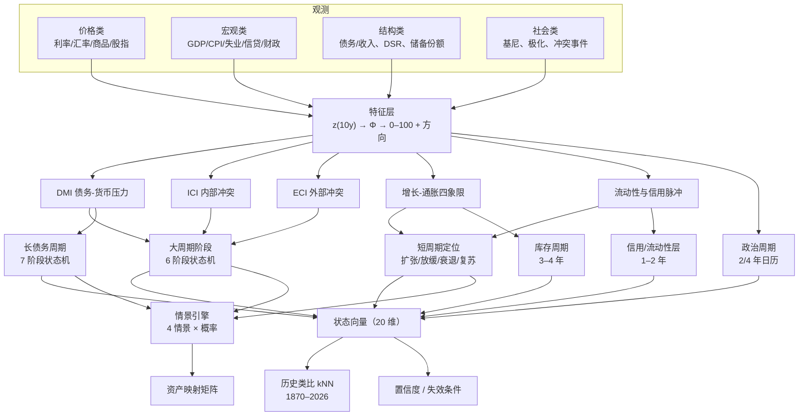

# 22 EPIC-C 周期引擎 2.0（可计算化的达利欧框架）

> 目标：把「现在是周期什么位置」从一句叙事，变成**可计算、可分解、可回测、可证伪**的引擎输出。
> 依据：`docs/research/dalio-framework.md`（原文与出处）｜ 思想来源：`docs/03-分析框架与模型设计.md` ｜ 透明化规范：[19](./19-透明化业务流程设计.md)
> 现状基线：`backend/app/analytics/regime.py`（5 因子 z-score → tanh → 0–100，四象限，固定置信度）。

---

## 1. 设计原则

| # | 原则 | 含义 |
|---|---|---|
| P1 | **先定位，再预测** | 周期引擎的第一职责是回答「我在哪」，而不是「明天涨跌」 |
| P2 | **机制优先于拟合** | 每个因子都要有经济学机制（收入/债务/利率/汇率），拒绝纯黑箱 |
| P3 | **可证伪** | 每个阶段判断必须附带「什么数据会推翻它」 |
| P4 | **状态机 + 滞回** | 阶段切换要慢，避免在阈值边缘抖动 |
| P5 | **口径显式** | 「长周期 75–100 年」与「250 年」两种说法并列，不悄悄取一个 |
| P6 | **样本外检验** | 阈值不许在样本内调到最优；48 案例多在金本位/固定汇率时代，不能直接外推 |
| P7 | **主观部分降级** | 不可计算的判断标 E4，不参与打分，只作解释 |

---

## 2. 与 V1.3 的差异

| 维度 | V1.3 `regime.py` | V2.0 EPIC-C |
|---|---|---|
| 输入 | 5 个因子 | 4 个国家/地区 × 18 个指标 + 12 个全球指标 |
| 映射 | `tanh(z/2)*100` | 10 年滚动 z → 正态 CDF → 0–100；方向可翻转 |
| 结构 | 单层四象限 | 三层（世界/国家/资产）× 五层周期 |
| 置信度 | 写死 0.4 / 0.35 | 覆盖率 × 一致性 × 校准 × 陈旧惩罚（见 §12） |
| 输出 | `{quadrant, score, confidence}` | `CycleState`：阶段 + 概率 + 贡献分解 + 规则命中 + 失效条件 + 类比 |
| 可复现 | 否 | 是（`derivation_id` + vintage） |
| 校验 | 无 | 阶段转换混淆矩阵 + Brier + 样本外 |

> **兼容**：`/api/analytics/regime` 保留旧格式（`legacy=true` 时返回 V1.3 结构），新接口 `/api/cycle/*`。

---

## 3. 总体架构



**三层定义**：

| 层 | 对象 | 作用 |
|---|---|---|
| **世界层** | 全球秩序、储备货币、大国实力 | 决定「游戏规则」，变化最慢，影响最大 |
| **国家层** | 美 / 中 / 欧 / 日 / 新兴市场 | 决定各国的政策空间与资产定价 |
| **资产层** | 股/债/汇/商品/黄金/信用 | 把周期定位翻译成资产倾向（概率加权，非指令） |

---

## 4. 指标体系（18 + 12）

### 4.1 国家层指标（每国 18 项）

| # | 指标 | 公式 / 口径 | 频率 | 角色 | 数据源 |
|---|---|---|---|---|---|
| 1 | 总债务/GDP | 政府+企业+家庭，BIS 口径 | 季 | DMI | BIS |
| 2 | 政府债务/GDP | IMF 口径 | 季/年 | DMI | IMF |
| 3 | 偿债率 DSR | 还本付息/收入 | 季 | DMI | BIS |
| 4 | 财政赤字/GDP | 广义政府 | 年/季 | DMI | IMF FM |
| 5 | 名义 GDP 增速 | 同比 | 季 | r−g | FRED/统计局 |
| 6 | 10Y 名义收益率 | 日 | r−g | 已有 |
| 7 | **r − g** | 10Y − 名义 GDP 增速 | 季 | 债务可持续性 | 计算 |
| 8 | 利息/财政收入 | 利息支出 ÷ 政府收入 | 年 | 债务可持续性 | IMF |
| 9 | 政策利率 | 日 | 顶部/推绳子 | 央行 |
| 10 | 期限利差 | 10Y − 2Y | 日 | 顶部 | 已有 |
| 11 | 实际利率 | 10Y − BE | 日 | 货币条件 | 已有 |
| 12 | 央行资产/GDP 同比 | WALCL 等 | 周/月 | 印钞 | FRED/央行 |
| 13 | M2 增速 | 同比 | 月 | 印钞 | FRED/央行 |
| 14 | 私人信贷增速 | 银行信贷同比 | 月 | 推绳子 | BIS/央行 |
| 15 | REER 偏离 | 实际有效汇率对 10 年均值偏离 | 月 | 货币贬值 | BIS |
| 16 | CPI 同比 / 核心 | 月 | 通胀 | 统计局 |
| 17 | 产出缺口 | HP 滤波或 IMF 估计 | 季 | 短周期 | OECD/IMF |
| 18 | 失业率 | 月 | 萧条 | 统计局 |

### 4.2 全球/结构层指标（12 项）

| # | 指标 | 用途 | 来源 |
|---|---|---|---|
| G1 | 储备货币份额（美元/欧元/人民币） | 世界层核心 | IMF COFER（季度，滞后 1 季） |
| G2 | 跨境支付份额 | 储备货币的先行 | SWIFT RMB Tracker |
| G3 | 各国 GDP 份额（PPP 与市场汇率两口径） | 实力指数 | IMF WEO / Maddison |
| G4 | 军费份额 | ECI | SIPRI Milex |
| G5 | 出口份额 | 贸易实力 | WTO |
| G6 | 专利族/研发强度 | 创新 | WIPO/OECD |
| G7 | 人力资本/PISA | 教育 | World Bank/OECD |
| G8 | 金融中心指数 | 金融实力 | GFCI（半年） |
| G9 | 财富基尼 / 前 1% 份额 | ICI | WID.world |
| G10 | 抗议/骚乱/政治暴力事件数 | ICI | ACLED/UCDP |
| G11 | 极化指数 | ICI | V-Dem/学术指数 |
| G12 | 制裁/出口管制/关税频次 | ECI | Global Sanctions DB + 自建 |

> **必须锁定的口径**：债务用 BIS「总信贷」还是 IMF「政府债务」，两者差 60–90pp，混用会得出完全相反的结论。引擎配置文件 `cycle.yaml` 中每个指标只能绑定一个 `source_id`。

---

## 5. 特征工程

### 5.1 标准化

```
z = (x − mean_10y) / sd_10y              # 10 年滚动，避免长周期漂移
score = 100 × Φ(z)                        # 正态 CDF → 0..100 的「历史分位」
方向的统一：所有 score 都调成「越高 = 该维度压力越大 / 越危险」
  · 债务/GDP、DSR、赤字率、极化、军费份额 → 直接取 score
  · 名义增长−利率、教育、创新、储备份额 → 取 100 − score
```

为什么用 `Φ(z)` 而不是 min-max：可跨指标可比、对极端值稳健、解释为「历史分位」。

### 5.2 缺失与陈旧

| 情形 | 处理 | 置信度影响 |
|---|---|---|
| 序列缺失 > 20% | 该指标退出合成 | 覆盖率下降 |
| 最新值滞后 > 1.5 个更新周期 | 用上一值 + 标 `stale` | 每项 −0.05，上限 −0.3 |
| 数据修订导致方向翻转 | 记录 `revision_flag`，输出「待复核」 | −0.1 |

### 5.3 频率对齐

- 日频 → 月末取最后一个值（避免用未来信息）；
- 季频 → 按发布日对齐（`vintage_date`），不是按季度末；
- 年频 → 用「该年数据首次发布日」对齐。

> 这条是回测可信度的命门：2024 年的 GDP 修订值不能在 2024 年当月的回放里出现。

---

## 6. 三大子指数

### 6.1 DMI 债务-货币压力指数

```
DMI = 100 × Σ w_i · score_i / Σ w_i
  score: 总债务/GDP(0.20) · DSR(0.15) · 赤字率(0.15) · 央行资产/GDP同比(0.15)
         REER 偏离(0.10) · 储备份额变化(0.10) · 利息/收入(0.10) · r−g(0.05)
```

阈值（初始值，待回测校准）：`DMI < 30` 健康；`30–60` 积累；`60–80` 紧张；`> 80` 危机模式。

### 6.2 ICI 内部冲突指数

```
ICI = 100 × Σ w_i · score_i / Σ w_i
  score: 财富基尼(0.25) · 前 1% 份额(0.15) · 极化(0.20)
         抗议/骚乱事件(0.20) · 政府信任(0.10) · 实际收入中位数增速(0.10)
```

### 6.3 ECI 外部冲突指数

```
ECI = 100 × Σ w_i · score_i / Σ w_i
  score: 军费份额(0.20) · 大国实力差缩小(0.20) · 制裁/出口管制(0.20)
         关税水平(0.15) · 冲突死亡数(0.15) · 联盟/条约退出(0.10)
```

> 三个指数共用同一把 0–100 的尺，是为了能在雷达图上直接比较「哪根弦最紧」。

### 6.4 风险合成

```
RISK = 0.4·DMI + 0.3·ICI + 0.3·ECI        （权重可配置，进规则库）
```

**「有毒组合」判定**（达利欧第五阶段特征）：`DMI>65 且 ICI>65 且 近 12 个月有重大负面冲击` → `stage5_warning = true`。

---

## 7. 五层周期定位

### 7.1 长债务周期（7 阶段状态机）

| 阶段 | 判定（初始阈值） | 关键观测 |
|---|---|---|
| 1 早期 | DMI<30 且 信贷/GDP 缺口<2 | 债务增速 ≤ 收入增速 |
| 2 泡沫 | DMI 30–60 且 (债务增速−GDP增速) 3 年累计>3pp 且 泡沫 7 特征命中≥4 | 杠杆买入、新买家涌入、估值高 |
| 3 顶部 | 政策利率 12 个月累计+150bp 或 期限利差倒挂 或 信贷问题新闻密度突增 | 紧缩最快发生在股市见顶前约 5 个月 |
| 4 萧条 | 实际 GDP 连续 2 季负增长 且 DSR 高位 且 政策利率≤1% | 通缩、资产价格跌约 50% |
| 5 漂亮去杠杆 | 名义增长−名义利率>0 且 债务/GDP 同比下降 且 CPI<6% | 印钞约 GDP 4%/年 |
| 6 推绳子 | 政策利率≤0.5% 且 央行资产/GDP 同比>20% 但 私人信贷增速<名义 GDP | 钱不进实体 |
| 7 正常化 | 实际 GDP 回到前高 且 股价回到前高 | 恢复需 5–10 年 |

**滞回规则**：进入阈值与退出阈值分离（如进入 5 需 `r−g>+1pp`，退出需 `<−0.5pp`）；连续 3 个月满足才切换，单月不切换。

### 7.2 短债务周期（5–8 年，4 阶段）

```
growth_momentum = 0.4·z(产出缺口) + 0.3·z(PMI) + 0.3·z(信贷脉冲)
policy_stance   = −z(实际利率) − 0.5·Δz(期限利差)
```

| 阶段 | 条件 |
|---|---|
| 扩张 | growth_momentum > 0.3 且 policy_stance > 0 |
| 过热 | growth_momentum > 0.3 且 policy_stance < 0 |
| 放缓 | growth_momentum < −0.3 且 policy_stance < 0 |
| 复苏 | growth_momentum < 0 但拐点向上（3 个月二阶差分>0） |

### 7.3 库存周期（3–4 年）

用「库存/销售比」或其代理（制造业库存指数、PPI-CPI 剪刀差、铜金比）划分：主动补库 / 被动补库 / 主动去库 / 被动去库。

### 7.4 信用/流动性层（1–2 年）

```
liquidity_impulse = Δ(央行资产/GDP, 3m) − Δ(财政存款/TGA) + Δ(逆回购)
credit_impulse    = Δ(私人信贷/GDP, 6m)
```

四态：宽松/中性/收紧/枯竭。与短周期组合可给出「政策-增长」错位图。

### 7.5 政治周期（2/4 年）

日历驱动：美国中期选举（2026-11）、总统大选（2028）、中国五年规划（2026 起「十五五」）、欧央行/日本央行换届、G20 轮值。**不是预测选举结果，而是把「制度事件窗口」标在时间轴上**，并提示「此窗口内政策不确定性上升」。

---

## 8. 大周期（世界秩序）六阶段

判定用合成指标 + 手动校准相结合，输出「世界层」与「美国/中国层」两套：

| 阶段 | 判定特征 | 当前（2026-11）证据 |
|---|---|---|
| 1 新秩序 | 战争/革命后新规则建立 | — |
| 2 制度建设 | 制度、税收、货币体系成型 | — |
| 3 和平繁荣 | 生产率↑、贸易扩张、制度自信 | 中国被达利欧置于 3→4（2022 访谈） |
| 4 债务与分歧 | 债务堆积、资产泡沫、民粹抬头 | 美国：债务 40.6 万亿、赤字 5.8% GDP、评级 Aa1 |
| 5 财政糟糕+冲突激烈 | 赤字失控、极化、规则失效 | 美国：DMI/ICI 同步高位（见 §16） |
| 6 内战/革命 | 秩序崩溃 | — |

> **注意**：达利欧 2026-01「第 5→6 边缘」针对美国，2026-02「世界已进入第六阶段」针对国际秩序。两者**对象不同**，产品中必须分开显示：`美国内部秩序阶段` 与 `国际秩序阶段`。

### 8.1 帝国兴衰八项实力 → 实力指数 SPI

```
SPI_c = 100 × Σ w_j · norm(indicator_j)
  教育(0.15) · 创新(0.20) · 成本竞争力(0.10) · 军力(0.15)
  贸易(0.15) · 经济产出(0.15) · 金融中心(0.05) · 储备货币(0.05)
```

储备货币权重故意压低：它**滞后于实力**（达利欧原文「significant lag」），适合做「确认」而非「领先」。

---

## 9. 债务可持续性引擎

核心三个方程：

```
① r − g：债务动态的一阶条件
   债务/GDP 变化 ≈ (r − g)·d − 基本盈余/GDP
   r > g → 债务比自我膨胀（除非有基本盈余）

② 利息负担：利息/财政收入
   > 20% 警戒，> 30% 危险（阈值待校准）

③ 三模式判别
   通胀化债：DMI 高 + 本币债占比高 + 央行可货币化 + CPI 抬头 → 名义增长稀释
   通缩化债：DMI 高 + 本币债 + 私人部门去杠杆 + CPI 低 → 萧条/漂亮去杠杆
   财政主导：央行被动配合财政（YCC/QE）+ 通胀波动 → 实际利率被压低
```

**当下美国读法**（用 §16 的真实数据）：`10Y=5.12%、名义 GDP 增速约 4–4.5%` → `r−g ≈ +0.7~1.1pp`（不利）；`利息/财政收入约 25%`（警戒区）；本币债务占比高（约 2/3 内债）+ 关税收入 + 财政赤字 5.8% GDP → **偏向「财政主导 + 通胀化债」**，而非通缩型萧条。这也是黄金与实际利率背离的机制解释。

> **C 级声明**：长债务周期的「75–100 年」是叙事分期，非统计检验结论（n≈5、起止点事后划定）；BIS 金融周期（15–20 年）是更强的实证替代框架。UI 必须把这一层标为「框架假设」，并禁止用正弦波叠加预测拐点。

---

## 10. 状态向量与历史类比

### 10.1 状态向量（20 维）

```
v = [DMI, ICI, ECI, r−g, 期限利差, 实际利率, CPI, 产出缺口,
     失业率变化, 信贷脉冲, 央行资产增速, REER 偏离, 储备份额变化,
     股市 12m 动量, 黄金 12m 动量, 商品 12m 动量, 美元 12m 动量,
     基尼, 军费份额, 泡沫特征命中数]
```

标准化后做余弦相似度 + 欧氏距离加权：

```
sim(a,b) = 0.6·cos(a,b) + 0.4·(1 − ||a−b||/√20)
```

### 10.2 类比输出（每国 Top 5）

| 字段 | 内容 |
|---|---|
| `analog_year` | 最相似年份（如 1968、1973、2000、2007） |
| `similarity` | 0–1 |
| `what_happened_next_12m` | 后续 12 个月：GDP、CPI、股指、10Y、黄金的实际变化 |
| `n_cases` | 相似度 > 阈值的历史月份数 |
| `caveat` | 「样本多为金本位/固定汇率时代」等提醒 |

> 类比的用途不是「历史会重演」，而是**给出条件分布**：如果现在是 1968 型，那么未来 12 个月通胀上行概率多大、股债怎么走。必须显示样本数与分布，而不是只挑一个最像的年份讲故事。

---

## 11. 情景引擎与资产映射

### 11.1 四情景（世界层，2026-11 示例输出）

| 情景 | 触发条件 | 概率（示例） | 关键资产倾向 |
|---|---|---|---|
| **S1 财政主导 + 期限溢价上行** | 赤字>6%、拍卖疲弱、10Y>5.5%、BE 上行 | 35% | 黄金↑ 长债↓ 美元先强后弱 价值股>成长股 |
| **S2 增长下行 + 温和宽松** | 产出缺口转负、失业上行、通胀回落 | 30% | 长债↑ 黄金震荡 防御股↑ 信用利差走阔 |
| **S3 信用事件/流动性冲击** | 信用利差跳升、融资市场冻结、私募信贷赎回 | 20% | 美元急升 黄金先跌后涨 现金>一切 |
| **S4 AI 生产率繁荣** | 生产率增速上台阶、单位成本下降、盈利广谱改善 | 15% | 成长股↑ 实际利率↑ 黄金↓ 商品分化 |

> 概率为引擎按「当前状态向量 + 规则权重」生成，**不是投资建议**；每月复核，进入预测台账。

### 11.2 资产映射矩阵（4 象限 × 8 类资产）

| 增长/通胀 | 股票 | 长债 | 短债 | 黄金 | 商品 | 美元 | 信用 | 新兴市场 |
|---|---|---|---|---|---|---|---|---|
| ↑增长 ↑通胀（过热） | 中性 | ↓ | ↓ | ↑ | ↑↑ | ↓ | 中性 | 中性 |
| ↑增长 ↓通胀（复苏） | ↑↑ | 中性 | 中性 | ↓ | 中性 | ↓ | ↑ | ↑ |
| ↓增长 ↑通胀（滞胀） | ↓↓ | ↓ | 中性 | ↑↑ | ↑ | ↑ | ↓↓ | ↓↓ |
| ↓增长 ↓通胀（衰退） | ↓ | ↑↑ | ↑↑ | 中性 | ↓↓ | ↑ | ↓ | ↓ |

箭头是**倾向**不是仓位；每条映射必须挂 `method_id`，可被回测检验（过去 N 次该象限下 3 个月资产中位数收益）。

---

## 12. 置信度、证据等级与失效条件

```
confidence = coverage^0.5 × agreement × calibration_factor × (1 − staleness_penalty)
上限：未校准时 ≤ 0.70；覆盖率<60% 时禁止输出方向性结论
```

| 字段 | 计算 |
|---|---|
| `coverage` | 该层所需指标可用比例 |
| `agreement` | 子指数同向比例与离散度（0.5–1） |
| `calibration_factor` | 该阶段判定的历史 Brier 相对基准的改进，映射到 0.6–1 |
| `staleness_penalty` | 每项陈旧 −0.05，上限 −0.3 |

**失效条件（falsifier）示例**：

- 「美国处于长债务周期晚期/财政主导」→ 失效：`US30Y 连续 3 个月回落至 4.5% 以下且金价同步下跌 >15%`
- 「泡沫阶段」→ 失效：`信贷/GDP 缺口连续 2 季回落至 <2 且估值回到中位数`
- 「推绳子」→ 失效：`私人信贷增速连续 2 季 > 名义 GDP 增速`

---

## 13. 输出 Schema

```json
{
  "asof": "2026-11-17",
  "run_id": "RUN-20261117-1610",
  "layers": {
    "world": {
      "order_stage": 6,
      "order_stage_label": "国际秩序：规则失效/丛林法则",
      "us_internal_stage": 5,
      "cn_internal_stage": 4,
      "confidence": 0.62,
      "dmi": 71.3, "ici": 68.4, "eci": 74.1
    },
    "country": {
      "US": {
        "long_debt_phase": "late_fiscal_dominance",
        "short_cycle": "overheat",
        "inventory": "passive_build",
        "liquidity": "neutral_tight",
        "r_minus_g": 0.9,
        "interest_to_revenue": 0.23,
        "confidence": 0.66
      },
      "CN": {"long_debt_phase": "late_deleveraging_managed", "short_cycle": "slowdown", "confidence": 0.58}
    },
    "assets": {
      "quadrant": "增长放缓 / 通胀偏高",
      "scenarios": [
        {"id": "S1", "name": "财政主导+期限溢价上行", "p": 0.35},
        {"id": "S2", "name": "增长下行+温和宽松", "p": 0.30},
        {"id": "S3", "name": "信用事件/流动性冲击", "p": 0.20},
        {"id": "S4", "name": "AI 生产率繁荣", "p": 0.15}
      ]
    }
  },
  "analogs": [
    {"year": 1968, "similarity": 0.81, "next12m": {"gdp": 0.031, "cpi": 0.062, "spx": -0.08, "gold": 0.12}, "n": 14}
  ],
  "contributions": [{"name": "债务/收入", "value": 18.2}, {"name": "r−g", "value": 15.6}],
  "rules_hit": ["R-BC-03", "R-BC-07", "R-ORD-05"],
  "falsifiers": ["US30Y<4.5% 且金价-15%"],
  "derivation_id": "d_9f3c"
}
```

---

## 14. 回测与校验

| 校验 | 方法 | 通过标准 |
|---|---|---|
| 阶段识别 | 对 21 个通缩型历史案例做「事后阶段标注 vs 引擎输出」混淆矩阵 | 萧条/漂亮去杠杆两类召回 >0.7 |
| 时点正确 | 用 vintage 数据回放，检测是否用到未来修订值 | 0 次前视 |
| 阈值稳健 | 阈值 ±20% 扰动，阶段结论翻转率 | <20% |
| 类比有效性 | 相似度 Top-5 的后续 12m 资产收益是否比随机年份更集中 | 分位数检验 p<0.1 |
| 概率校准 | Brier 分解 + 可靠性曲线 | Brier < 基准率的 0.9 倍 |
| 规则价值 | 每条规则贡献的正负与显著性（去掉该规则后回测变化） | 无「负贡献规则」上线 |

> **诚实边界**：达利欧框架是「叙事 + 机制」，不是可证伪的量化模型。48 个案例大多发生在金本位/固定汇率时代，把阈值直接套到浮动汇率法币时代是危险的。因此本引擎的定位是 **结构化思考工具**，不是alpha 生成器。

---

## 15. 代码落地映射

```
backend/app/cycle/
├── __init__.py
├── catalog.py        # 指标目录、口径、数据源绑定（读 config/cycle.yaml）
├── features.py       # z-score、Φ 映射、频率对齐、vintage 处理
├── indices.py        # DMI / ICI / ECI / SPI
├── long_debt.py      # 7 阶段状态机 + 滞回
├── short_debt.py     # 4 阶段
├── inventory.py      # 库存四态
├── liquidity.py      # 信用/流动性
├── political.py      # 政治日历
├── world_order.py    # 六阶段（世界/美国/中国分开）
├── sustainability.py # r−g、利息负担、三模式
├── analog.py         # 状态向量 + kNN
├── scenarios.py      # 情景生成 + 概率 + 资产映射
├── confidence.py     # 置信度合成（与 19 共用）
└── runner.py         # 编排：产出 CycleState 并写 derivations

backend/app/api/cycle.py        # /api/cycle/overview|position|history|analogs|scenarios
backend/tests/test_cycle_*.py   # 金标准样本测试（固定输入 → 期望阶段）
config/cycle.yaml               # 指标绑定、权重、阈值、滞回、口径
data/reference/                 # 历史静态数据（实力指数、时间轴）
```

**测试策略**：每个状态机至少 3 个金标准样本（进入/维持/退出），用固定 JSON 输入断言输出阶段与置信度；阈值调整必须同步更新测试期望，防止「偷偷改结论」。

---

## 16. 当前读数示例（2026-11-17，基于 DB 真实数据）

> 以下为用快速原型逻辑手工计算，用于验证引擎设计是否「说得通」，**非正式输出**。

| 维度 | 读数 | 判定 |
|---|---|---|
| US 10Y / 2Y | 5.12% / 4.83%，+29bp | 未倒挂；短端高位 |
| US 实际利率 | 2.92%（BE 2.20%） | 货币条件紧 |
| US 30Y | 5.46% | 长端不信任财政 |
| 黄金 | 3864 美元（DB）；外部 WGC 转述 11 月上旬约 4,065–4,140，**差约 5% 需对账** | 若 3,864 属实：R-BC-07 命中；若 4,100 属实：则是「新高 + 实利率高企」，结论更强但必须先确认口径 |
| DXY | 103.57，高利率下未显著走强 | 美元信用溢价未扩张 |
| 中美 10Y 利差 | −349bp | 人民币压力 |
| 美股 | SPX 7416 高位 | 与「衰退」叙事背离 |
| 债务/GDP | 约 **133%**（40.6 万亿 / 30.6 万亿，2026-11-13） | DMI 高位；全球债务 311% GDP |
| 利息/财政收入 | 约 **25%**（估算） | 警戒区 |
| r − g | 约 +0.9pp | 债务比仍自我膨胀 |
| 美元储备份额 | 56.70%（2026Q2） | 缓降，非崩塌 |

**引擎综合判断（示例）**：

- 世界层：国际秩序处于**阶段 6（规则失效）**置信度中等；美国内部秩序处于**阶段 5**（财政糟糕 + 极化），接近 5→6 边缘；
- 长债务周期：**晚期 / 财政主导（通胀化债）**，而非通缩型萧条——因为本币债务为主、央行可货币化、黄金在给货币信用定价；
- 短周期：**过热后段 / 增长放缓初期**（高实际利率压制，但盈利仍强）；
- 主要矛盾：**期限溢价 vs 增长**。若长端继续上行而增长下行，进入滞胀象限；若财政妥协+降息，进入 S2。

> 这正是「透明化」要展示的东西：**判断 + 依据 + 概率 + 什么会推翻它**。

---

## 17. 已知局限

1. **历史太短**：多数序列 2019 起，10 年滚动 z-score 实际只有 6–7 年样本；需引入公开长期序列（Shiller、FRED 长序列、BIS）补齐。
2. **口径冲突**：债务/GDP、储备份额存在多口径，必须锁源并标注。
3. **政治/冲突数据滞后**：ACLED/UCDP 有延迟与漏报，ICI/ECI 会「后知后觉」。
4. **框架本身不可证伪**：达利欧的六阶段是解释性框架，阈值需长期校准，不能当预言机。
5. **单一国家样本**：美国是唯一同时具备「储备货币 + 高债务 + 内部分裂」的样本，历史类比天然稀缺。
6. **不要把「阶段」当交易信号**：阶段是背景，交易需要更短周期的触发（见 EPIC-T）。

---

## 18. 里程碑（与 18 §6 对齐）

| 阶段 | 内容 | 周 |
|---|---|---|
| C1 | 指标目录 + 特征层 + DMI/ICI/ECI（接入现有数据） | 2 |
| C2 | 长债务 7 阶段 + 短周期 4 阶段 + 置信度 | 2 |
| C3 | 债务可持续性 + 情景引擎 + 资产映射 | 1.5 |
| C4 | 状态向量 + 历史类比（需补历史数据） | 2 |
| C5 | 回测/校准 + 规则库 + 版本治理 | 1.5 |

**总计约 9 周**，可与透明化（M0/M1）并行，因为二者共用 `derivations` 与 `method_registry`。
